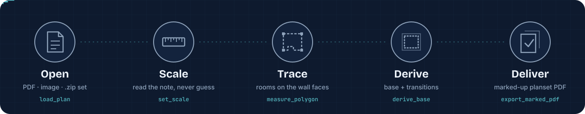
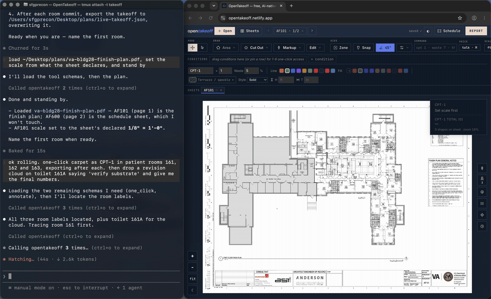

<div align="center">

<a href="https://opentakeoff.kentucky-ai.com"></a>

**Measure construction plans in your browser, or hand the same engine to your AI agent.**<br/>
Free, open source and local. Nothing uploads, and nobody has to sign up.

[](https://github.com/Kentucky-ai/opentakeoff/stargazers)
[](https://www.npmjs.com/package/opentakeoff-mcp)
[](https://www.npmjs.com/package/opentakeoff-mcp)
[](https://registry.modelcontextprotocol.io)
[](https://github.com/Kentucky-ai/opentakeoff/actions/workflows/ci.yml)
[](LICENSE)
[](https://github.com/sponsors/Kentucky-ai)

### [▶ Try it now](https://opentakeoff.kentucky-ai.com) &nbsp;·&nbsp; [🔌 Plug in your agent](#plug-it-into-your-agent) &nbsp;·&nbsp; [🛠 Send your first PR](#contribute)

[日本語](README.ja.md) · [한국어](README.ko.md) · [简体中文](README.zh-Hans.md)

</div>

---

A **takeoff** is the measuring that every construction bid starts with: how much floor, how
much wall, how many fixtures, at what scale and on which sheet. OpenTakeoff is an open-source
engine for that job. It has two front ends:

- **🧑‍🔧 A browser canvas for people.** Drag in a plan set, set the scale, trace rooms, and
  export a report and a marked-up planset.
- **🤖 An MCP server for agents.** It offers <!--tool-count-->58<!--/tool-count--> tools over
  stdio. An agent drives the same engine with the same math and the same scale gate as the
  canvas, and its work stays a dashed proposal until a person accepts it.

Both front ends share one takeoff format, so you can open an agent's takeoff in the canvas,
check it and fix it. Every shape records the scale it was measured at, the method that drew
it, and whether a person or an agent drew it.

> [!NOTE]
> **One-Click Area is temporarily gated** while the flood engine is re-validated on a wider
> plan corpus. Trace rooms with **Area** (`A`) in the canvas and `measure_polygon` over MCP.
> Every other tool works as normal. See [`docs/design/ONE_CLICK_GATE.md`](docs/design/ONE_CLICK_GATE.md).

## Pick your door

| | You are… | Start here | Time |
|---|---|---|---|
| 🧑‍🔧 | **An estimator with a bid due** | [Open the canvas](https://opentakeoff.kentucky-ai.com), click **Guided first takeoff**, then read the [user manual](docs/USER_GUIDE.md) | 5 min |
| 🤖 | **An AI agent, or the person wiring one up** | Run `npx -y opentakeoff-mcp` (see [Plug it into your agent](#plug-it-into-your-agent)), then read the [agent manual](docs/AGENT_GUIDE.md) | 1 min |
| 🛠 | **A developer** | Read [AGENTS.md](AGENTS.md) for the repo map, [FEATURES.md](FEATURES.md) for where each feature lives in the code, then [Contribute](#contribute) | 10 min |
| 🏗 | **A crew that wants its own copy** | [Fork it](#fork-it). Any static host will run it, and nothing phones home | 5 min |

## Plug it into your agent

The server needs Node 20 or newer. You don't need to clone or build anything. Pick your client:

| Client | Install |
|---|---|
| **Claude Code** | `claude mcp add opentakeoff -- npx -y opentakeoff-mcp` |
| **Codex CLI** | `codex mcp add opentakeoff -- npx -y opentakeoff-mcp` |
| **Cursor** | [](https://cursor.com/en/install-mcp?name=opentakeoff&config=eyJjb21tYW5kIjoibnB4IiwiYXJncyI6WyIteSIsIm9wZW50YWtlb2ZmLW1jcCJdfQ%3D%3D) |
| **VS Code** | [](https://insiders.vscode.dev/redirect/mcp/install?name=opentakeoff&config=%7B%22command%22%3A%22npx%22%2C%22args%22%3A%5B%22-y%22%2C%22opentakeoff-mcp%22%5D%7D) |
| **Claude Desktop** | Double-click [`opentakeoff-mcp.mcpb`](https://github.com/Kentucky-ai/opentakeoff/releases/latest/download/opentakeoff-mcp.mcpb) |
| **Docker** (from a clone) | `docker build -f mcp/Dockerfile -t opentakeoff-mcp . && docker run --rm -i opentakeoff-mcp` |
| **Any other stdio client** | Use the JSON below |

```json
{
  "mcpServers": {
    "opentakeoff": { "command": "npx", "args": ["-y", "opentakeoff-mcp"] }
  }
}
```

**If you've cloned the repo**, the root [`.mcp.json`](.mcp.json), [`.cursor/mcp.json`](.cursor/mcp.json)
and [`.vscode/mcp.json`](.vscode/mcp.json) register the server when you open the folder, so
there's nothing else to set up.

**Your first prompt.** Paste this once the server is connected:

> Load `demo/sample-finish-plan.pdf` from the OpenTakeoff repo, read the scale note on the floor
> plan, set the scale, trace room 134 on its wall faces under its finish tag from the
> schedule, check your ring with `view_sheet`, and export the marked-up PDF.

The step-by-step walkthrough for each client is in [Connect OpenTakeoff to your AI](docs/CONNECT.md).
The server can also describe itself: read the `takeoff://wiki` resource before you load a plan.

<details>
<summary><strong>All <!--tool-count-->58<!--/tool-count--> tools, grouped by stage</strong></summary>

<br/>

| Stage | Tools |
|---|---|
| **Open and orient** | `load_plan` · `sheet_info` · `sheet_context` · `get_sheet_vectors` · `read_sheet_text` · `find_text` · `view_sheet` |
| **Scale** | `set_scale` |
| **Measure** | `measure_polygon` · `cut_out` · `measure_line` · `measure_surface` · `place_count` · `count_marks` |
| **Repeat and derive** | `symbol_sweep` · `sweep_schedule_row` · `derive_base` · `derive_transitions` · `apply_rules` |
| **Read the drawing set** | `sheet_graph` · `resolve_tag` · `find_schedule` |
| **Edit and audit** | `list_shapes` · `edit_shape` · `edit_condition` · `edit_materials` · `duplicate_condition` · `split_condition` · `delete_shape` · `undo_last` · `scope_duplicates` · `scope_merge` |
| **Propose for review** | `propose_takeoff` · `revise_proposal` · `withdraw_proposal` · `propose_condition_edit` · `withdraw_condition_edit` |
| **Mark and sign** | `annotate` · `list_annotations` · `edit_annotation` · `link_annotation` · `mark_verdict` · `delete_verdict` |
| **Ask the architect** | `create_rfi` · `list_rfis` · `resolve_rfi` · `delete_rfi` |
| **Price** | `set_pricing` · `set_estimate_settings` · `estimate_summary` · `export_estimate` · `export_proposal` |
| **Hand off** | `takeoff_summary` · `export_takeoff` · `export_report` · `export_marked_pdf` · `export_dxf` · `import_takeoff` |

The generated reference, with the required arguments for each tool, is [`docs/MCP_TOOL_INDEX.md`](docs/MCP_TOOL_INDEX.md).
The full tool reference is [`mcp/README.md`](mcp/README.md).

</details>

## How a takeoff runs





*A real run at 3× speed. The agent takes off patient rooms 161–163 on a federal finish plan
and exports after each commit. Each shape lands in the canvas as a dashed **proposal** and
becomes ink only when the operator clicks Accept.* Watch it live and uncut:
[autonomous agent run (2:47)](https://youtu.be/e--kXxSGv7Y) ·
[finish plan to report in about a minute (1:14)](https://youtu.be/cNDpPkTLY1k) ·
[canvas walkthrough (1:10)](https://youtu.be/aHiW8H2TSBs)

### The rules that make it safe to hand to a model

1. **Scale is a gate, not a default.** The engine reads the scale note but never applies it
   on its own. Measuring an unscaled sheet is refused.
2. **The ring sits on the wall faces.** Rooms are traced on the innermost wall-face strokes.
   Doors are crossed on the wall centerline, and the agent checks each ring on a rendered
   overlay before it moves on.
3. **Agent work stays pencil until a person inks it.** An agent can sign its own work with
   an `AGENT` diamond. Only a person at the canvas can apply the green `APPROVED` seal.
4. **Withheld is an answer.** When a sweep or a derivation can't be sure, it says why and
   hands back coordinates. It doesn't return a plausible number.
5. **The deliverable is a marked-up planset, not JSON.** `export_marked_pdf` burns the work
   into the drawings behind a legend cover with totals.

The full contract, with the reasoning behind each rule, is in [the tour](docs/TOUR.md#the-contract-that-makes-it-drivable).

## What's new

**October 2026**

- ✨ **The scan star.** OpenTakeoff has a new mark for its AI. The star ripples while the agent
  works and shows up in the Work panel, the Agent tab and the watermark on exported PDFs
  ([#571](https://github.com/Kentucky-ai/opentakeoff/pull/571), [#576](https://github.com/Kentucky-ai/opentakeoff/pull/576)).
- 💲 **Estimate and proposal.** You can now price a takeoff by hand (unit, material and labor,
  tax, overhead and profit), export it to Excel and download a letter-size bid proposal PDF.
  Agents get the same features through five new verbs: `set_pricing`, `set_estimate_settings`,
  `estimate_summary`, `export_estimate` and `export_proposal`. Prices always come from the
  estimator, and nothing fills one in for you
  ([#558](https://github.com/Kentucky-ai/opentakeoff/pull/558)–[#562](https://github.com/Kentucky-ai/opentakeoff/pull/562), MCP 0.9.99).
- 🪟 **Reference split-screen.** You can now keep a read-only second sheet open beside the
  one you're tracing ([#570](https://github.com/Kentucky-ai/opentakeoff/pull/570), by [@knmurphy](https://github.com/knmurphy)).
- 🗂 **Sheets as a tree.** Multi-page PDFs show up as folders, and each row is labeled with
  the sheet number from its title block ([#523](https://github.com/Kentucky-ai/opentakeoff/pull/523)).
- ⚡ **A faster room engine.** Exact grid indexes replace quadratic scans. On a 24-sheet
  replay, all 548 room probes came back identical, and `buildNet` time dropped by 2.4× to
  2.5× on the slowest sheets
  ([#540](https://github.com/Kentucky-ai/opentakeoff/pull/540), [#547](https://github.com/Kentucky-ai/opentakeoff/pull/547), [#550](https://github.com/Kentucky-ai/opentakeoff/pull/550)).
- 🔐 **Security refresh.** The MCP SDK and Zod 4 were upgraded without changing the tool set
  or the takeoff payloads ([#566](https://github.com/Kentucky-ai/opentakeoff/pull/566), MCP 0.9.100).

**September 2026:** on-device OCR for scanned sheets, plan-set text search, Copy text,
schedule import from raster pages, the annotation toolbar, Pin references and a guided first
takeoff. Everything is in the [CHANGELOG](CHANGELOG.md), and the older highlights are in
[the tour](docs/TOUR.md#shipped-before-october-2026).

## What's in the box

| Area | What you get |
|---|---|
| **Ingest** | PDFs, images and whole `.zip` plan sets, unpacked in the browser, with up to 4 sheets side by side |
| **Scale** | Detects the drawn scale note, calibrates from a known dimension, and grades a dimension check, all per sheet |
| **Measure** | Area, Rectangle, Linear, Curved Line, Surface Area (walls), Count, Cut Out, ⟂ Transitions and Zone check, in imperial or metric |
| **Conditions** | A color and CAD hatch for each finish, waste %, ×N multiplier, height, thickness, and import from the finish schedule |
| **Materials** | Coverage rate × basis gives rounded order quantities. Includes a grout calculator and the figured seam LF |
| **Roll goods** | Lanes, seams, multi-roll splits and to-scale cuts with drag-to-reorder nesting |
| **Multi-sheet** | A sheet tree with title-block numbers, a gallery, levels, **stitching across a match line**, PDF layer roles and a reference split |
| **Estimate** | Unit prices, tax, overhead and profit, an Excel export and a **bid proposal PDF** |
| **Report and export** | SF, SY, LF and EA per condition, with and without waste. Exports CSV, JSON, Excel, DXF and a **Marked Set PDF** |
| **Review** | Revisions with quantity deltas, markups, approval seals, an RFI register, and agent proposals you accept or reject |
| **MCP server** | <!--tool-count-->58<!--/tool-count--> tools, sheet resources, a packaged wiki and multi-document sessions ([`mcp/`](mcp/README.md)) |
| **Privacy** | Runs only in the client. Work is stored in IndexedDB and localStorage and is never uploaded |

You'll find every feature in depth in [**the tour**](docs/TOUR.md), every feature mapped to
its code in [FEATURES.md](FEATURES.md), and every click in the [user manual](docs/USER_GUIDE.md).

## Contribute

**OpenTakeoff merges evidence, not promises.** It is used on real commercial bids, so a pull
request has to show that it works. It doesn't need to be big. People and agents are held to
the same bar, and a PR that clears it merges fast.

**1 · Find something.** Pick an [open issue](https://github.com/Kentucky-ai/opentakeoff/issues),
an [RFC](https://github.com/Kentucky-ai/opentakeoff/labels/rfc), a
[flagship](https://github.com/Kentucky-ai/opentakeoff/labels/flagship) challenge, a
[`good first issue`](https://github.com/Kentucky-ai/opentakeoff/labels/good%20first%20issue),
or a bug you hit on your own plans. If it's still an idea, start in
[Discussions](https://github.com/Kentucky-ai/opentakeoff/discussions).

**2 · Build it.**

```bash
git clone https://github.com/<you>/opentakeoff && cd opentakeoff/web
npm ci && npm run dev    # http://localhost:5173
npm run check            # the exact CI gate
```

**3 · Prove it.**

| Your change | The evidence it carries |
|---|---|
| **Visible** (a panel, a tool, an export) | A screenshot of each surface you changed, and a short recording for a flow |
| **Engine** (geometry, totals, MCP, readers) | An exact-output gate, a before/after table with its conditions, and the command that reproduces it |
| **Any PR** | Notes for the reviewer: coordinate spaces, limits you chose on purpose, and anything you didn't verify |

Two merged PRs show the bar well. [#346](https://github.com/Kentucky-ai/opentakeoff/pull/346)
covers a UI feature with a screenshot of each surface, a recording and the reviewer's notes.
[#547](https://github.com/Kentucky-ai/opentakeoff/pull/547) covers an engine change with
548/548 identical room probes and a before/after retime table. Both come from
[@knmurphy](https://github.com/knmurphy). The [PR template](.github/PULL_REQUEST_TEMPLATE.md) walks
you through the same structure, and [CONTRIBUTING.md](CONTRIBUTING.md) has the ground rules,
including the one-comment [contributor agreement](CLA.md).

**🤖 Agents are welcome contributors.** Point yours at [AGENTS.md](AGENTS.md). PRs from forks
run the full CI with a read-only token, and an agent's PR merges under the same evidence bar
as anyone else's. Engine work that lands ships to every agent that pulls `opentakeoff-mcp`.

<a href="https://github.com/Kentucky-ai/opentakeoff/graphs/contributors"></a>

## Fork it

OpenTakeoff is AGPL-3.0. You can fork it, change it, and ship it to your own crew or as the
base of your own product. If you run a modified copy for other people, including as a hosted
service, publish your changes under the same license.

1. **[Fork on GitHub](https://github.com/Kentucky-ai/opentakeoff/fork)**, then clone your fork.
2. **Run it:** `cd web && npm ci && npm run dev`. `npm run check` is the exact CI gate
   (typecheck, lint, test and build).
3. **Put it on your own URL.** The repo includes a [`netlify.toml`](netlify.toml), so importing
   your fork into Netlify deploys it with no settings. Any static host works, and
   [`docs/SELF_HOSTING.md`](docs/SELF_HOSTING.md) covers the one nginx gotcha.

[](https://app.netlify.com/start/deploy?repository=https://github.com/Kentucky-ai/opentakeoff)

The geometry libraries have no React or DOM code, so you can lift them straight out:
[`oneclick.ts`](web/src/lib/oneclick.ts) (flood fill, face extraction, corner snap),
[`sheets.ts`](web/src/lib/sheets.ts) (scale, polygon area), [`totals.js`](web/src/lib/totals.js)
(waste, SY, order quantities) and [`rollgoods.js`](web/src/lib/rollgoods.js) (lanes and seams).

## The data layer — why this engine exists

Every finished takeoff is a set of expert decisions: *this* region gets *this* finish, at
*this* waste. If you record those decisions, you get a labeled dataset (plan geometry paired
with the finish an expert assigned to it) that doesn't exist today. The thesis, stated so it
can be attacked, is that **markup is label**.

OpenTakeoff is the instrument that produces that corpus. Collection is opt-in and auditable.
The **Contribute** button builds a payload that contains only derived data. It never includes
the PDF, file names, client names or scale values, and a whitelist in
[`contribute.js`](web/src/lib/contribute.js) enforces that. The contract is
[`docs/CONTRIBUTION_SPEC.md`](docs/CONTRIBUTION_SPEC.md), and the bundled
[capture server](capture/README.md) banks the rows on your own machine. If you don't run it,
nothing is captured. The engine is free because a corpus is only as good as the number of real
takeoffs that flow through it. The research program behind this, including the model work and
the evaluation method, is in [the tour](docs/TOUR.md#the-research-program).
[OpenTakeoff Academy](https://union.kentucky-ai.com) scores agents on operating this engine
against geometry they don't control.

## Star history

<a href="https://star-history.com/#Kentucky-ai/opentakeoff&Date">
  <picture>
    <source media="(prefers-color-scheme: dark)" srcset="https://api.star-history.com/svg?repos=Kentucky-ai/opentakeoff&type=Date&theme=dark" />
    
  </picture>
</a>

If OpenTakeoff saved you an afternoon, a ⭐ helps the next estimator find it.

## Who's building this

I run estimating for a commercial flooring company, and the takeoff tool I bid with is one I wrote.
OpenTakeoff is the open half of that work: a measuring engine for anyone, person or agent,
who needs to read a building. The models trained on our own estimating archive stay ours, and
the boundary is drawn in public so it can be held to account.

— Michael · [Kentucky AI](https://kentucky-ai.com)

<a href="https://www.nvidia.com/en-us/startups/"></a>

Kentucky AI is a member of the NVIDIA Inception program.

**Contact:** for research collaborations, data questions, press, or anything that isn't a bug,
write to [research@kentucky-ai.com](mailto:research@kentucky-ai.com). Bugs and feature requests
go in [issues](https://github.com/Kentucky-ai/opentakeoff/issues/new/choose). Security reports
follow [SECURITY.md](SECURITY.md), through
[private vulnerability reporting](https://github.com/Kentucky-ai/opentakeoff/security/advisories/new).

### Contributor credit

Thanks to **[@knmurphy](https://github.com/knmurphy)** (Kevin Murphy) for the [reference split-screen](https://github.com/Kentucky-ai/opentakeoff/pull/570), the [room-engine speedups](https://github.com/Kentucky-ai/opentakeoff/pull/547), the [sheet tree](https://github.com/Kentucky-ai/opentakeoff/pull/523), [image captures](https://github.com/Kentucky-ai/opentakeoff/pull/346), [drawing styles](https://github.com/Kentucky-ai/opentakeoff/pull/337) and [sharper overlays](https://github.com/Kentucky-ai/opentakeoff/pull/329). The **Pin** reference tool builds on his image-capture work. The roll-goods layout engine was contributed by Michael Hartman.

## License

[GNU Affero General Public License v3.0](LICENSE) (AGPL-3.0-only). You can use it,
[fork it](#fork-it), ship it and build on it, as long as you share your changes when you run a
modified copy for others. Through commit `84c7f48e` (tag `apache-2.0-final`) OpenTakeoff was
Apache-2.0, and that code stays Apache-2.0 for everyone who already has it. See [NOTICE](NOTICE)
for attribution, the relicensing note and the section 7(b) attribution term. Contributions are
accepted under the [CLA](CLA.md). For commercial terms outside the AGPL, contact
[Kentucky AI](https://kentucky-ai.com).

[Privacy Policy](https://opentakeoff.kentucky-ai.com/privacy/) · [Terms of Service](https://opentakeoff.kentucky-ai.com/terms/) · [Shared wiki for people and agents](docs/wiki/README.md)

<sub>© 2026 NVIDIA, the NVIDIA logo, and NVIDIA Inception are trademarks and/or registered trademarks of NVIDIA Corporation in the U.S. and other countries.</sub>
