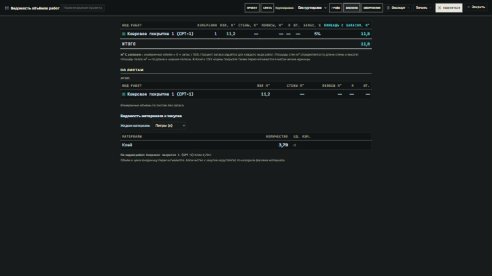
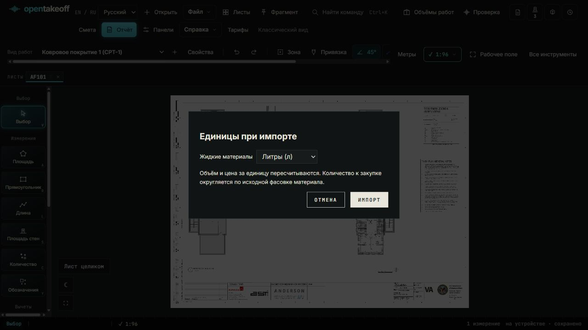

# OpenTakeoff — русская версия

Русский интерфейс OpenTakeoff для подсчёта объёмов работ по PDF-чертежам.

Переключатель **English / Русский** сохраняет выбор языка. Русский режим по умолчанию использует метры, квадратные метры и литры. Перевод не добавляет нормативных требований СП/ГОСТ и не меняет валюту проекта.

## Что изменено

- Переведены меню, инструменты, панели, ведомость объёмов, смета, формы организации и коммерческого предложения.
- Виды покрытий получили русские описания с сохранением исходных марок: например, «Ковровое покрытие 1 (CPT-1)».
- Ведомость и смета экспортируются в Excel с русскими листами и заголовками. PDF коммерческого предложения поддерживает кириллицу.
- При импорте можно выбрать литры или галлоны США; выбор доступен также в ведомости и смете. Количество, норма покрытия и цена за единицу пересчитываются вместе. Исходная фасовка и стоимость сохраняются.
- Масштабы в русском режиме показаны отношениями 1:50, 1:100 и т. п. После задания масштаба по известному размеру отображается рассчитанное отношение, например 1:78, либо эквивалент в футах при выборе имперских единиц.
- Кнопка закрытия закреплена справа сверху. Компактная палитра сохраняет исходные марки, полные описания доступны в подсказках.

## Предпросмотр





Снимки сделаны на публичном демонстрационном чертеже. Они показывают интерфейс; это не проверенная ведомость строительных объёмов.

## Запуск на компьютере

Требуются Node.js 24 и npm.

```sh
git clone --branch russian-localization https://github.com/Glade04/opentakeoff.git
cd opentakeoff/web
npm ci
npm run dev
```

Откройте http://localhost:5173 и выберите «Русский». Для производственной сборки используйте `npm run build`; результат появится в `web/dist`.

## Проверка

Проверено 3 ноября 2026 года в Windows, Node.js 24: штатный `npm run check` проходит целиком — TypeScript, ESLint, проверка ORT, 3609 успешных тестов, геометрический benchmark, сборка Vite и проверка OCR-сборки. Ошибок нет; 4 теста реальных моделей OCR/распознавания речи пропущены, поскольку модели не загружены.

Дополнительно: MCP — 294 успешных теста и 1 пропуск, протокол — 61 успешный тест, проверка ссылок документации — 3 успешных теста. Справочники MCP, версии пакетов и ссылки документации проходят проверку. Команды: `npm run typecheck && npm test && npm run check:tool-count && npm run check:wiki` в `mcp`, `npm run check` в `protocol`, `node --test scripts/check-doc-links.test.mjs` и `node scripts/check-doc-links.mjs` в корне.

Прежние 27 сбоев разобраны: часть возникала в обходном загрузчике TypeScript, остальные — при импорте PDF-модуля по пути Windows и проверке чисел без учёта языка системы. Исправлены также переносы строк эталонного CSV и проверка заголовков документации в Windows. Тесты не отключались, пороги benchmark сохранены. Это результаты локальной проверки, а не статус GitHub Actions.

Каталог перевода: `web/src/lib/i18n/ru.json`. После изменения выполните `node web/scripts/sync-russian-catalog.mjs`.

Исходные координаты, масштабы хранения, марки и машинные ключи JSON сохраняются. Галлоны здесь означают галлоны США; неизвестные единицы не переименовываются автоматически.

Лицензия проекта — AGPL-3.0. Лицензия встроенных шрифтов Noto Sans находится в `web/public/fonts/OFL.txt`.
