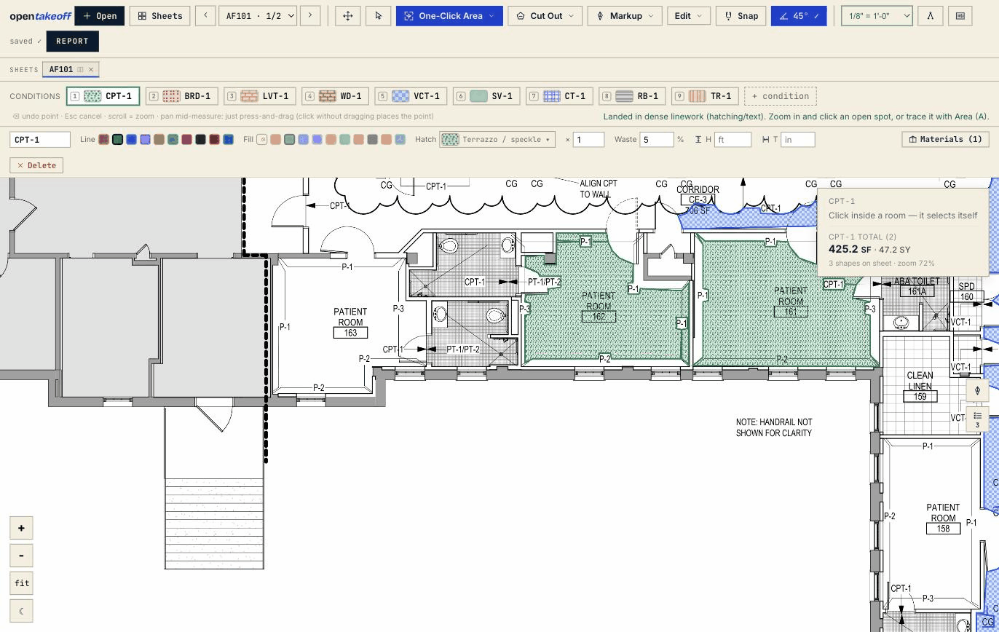
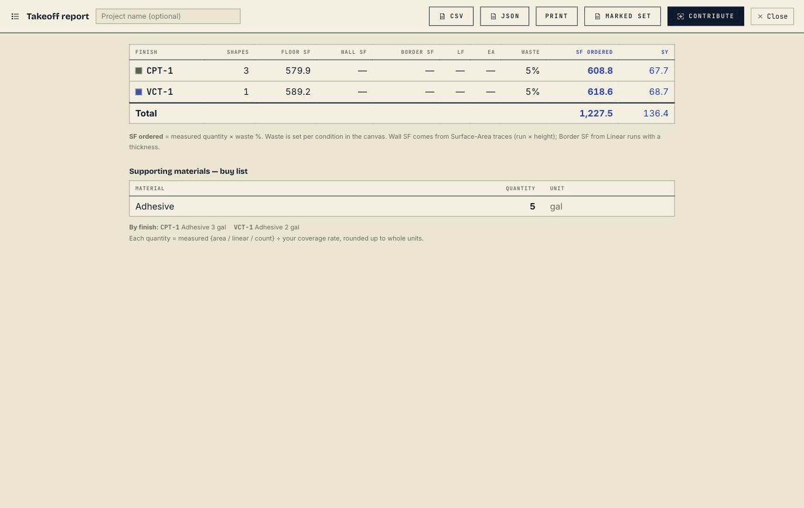

# The OpenTakeoff tour

Everything the engine and the canvas do, in depth. The [README](../README.md) is the short
version; this page keeps the long one. For step-by-step use, read the [user manual](USER_GUIDE.md);
for agents, the [agent manual](AGENT_GUIDE.md).

**One-Click Area is temporarily gated.** The flood engine is being re-validated against a wider plan corpus. Until that finishes the One-Click tool is off the canvas rail (`O` reports the gate) and the `one_click` / `detect_rooms` MCP verbs are **not registered**. Trace rooms with **Area** (`A`) in the canvas and `measure_polygon` over MCP. A build lifts the gate with `VITE_ONE_CLICK=1` (canvas) / `OPENTAKEOFF_ONE_CLICK=1` (server); see [`design/ONE_CLICK_GATE.md`](design/ONE_CLICK_GATE.md). Sections below that show One-Click describe the engine as it returns.

## Contents

- [What this is](#what-this-is)
- [The contract that makes it drivable](#the-contract-that-makes-it-drivable)
- [For the person at the canvas](#for-the-person-at-the-canvas)
- [Windows, macOS, Linux](#windows-macos-linux--all-of-it)
- [Workspace and memory](#workspace-and-memory)
- [Shipped before October 2026](#shipped-before-october-2026)
- [The research program](#the-research-program)

## What this is

Measuring quantities off a plan is the input to every construction bid—how much floor, how
much wall, how many fixtures, at what scale, on which sheet. It happens thousands of times a
day. Until OpenTakeoff there was **no open-source takeoff engine at all**, web-based or
otherwise, and nothing an autonomous agent could call.

OpenTakeoff is that engine, with two front ends sharing geometry and quantity modules:

- **Review cleanup**—agents can edit annotation text with undo while preserving geometry and review; RFI-linked notes require browser review. Scope warnings distinguish numeric edge residue from real small overlaps.
- **A stdio MCP server**—`npx -y opentakeoff-mcp` ([current tool list](MCP_TOOL_INDEX.md)), on the
  [official MCP registry](https://registry.modelcontextprotocol.io). An agent opens a plan,
  reads the title block, sets the scale, traces the rooms to their wall faces (the flood engine
  stays gated), checks its own work on a rendered overlay, and hands back a marked-up planset PDF.
- **A browser canvas**—no backend, no account, no upload. An estimator drags in a plan set
  and traces it, using One-Click room detection, CAD hatches, roll-goods seam layout, a
  materials buy list, and exports.

Neither is a wrapper around the other. The MCP server imports shared web modules, so quantity math
and takeoff records are compatible. Browser and MCP room-detection paths currently differ; shared
code does not guarantee identical boundaries on every plan. One-Click remains gated while that
boundary is re-validated.

**Provenance is the load-bearing part.** Every shape records the scale it was measured at, the
method that produced it (vector flood, raster trace, hand-drawn, agent-proposed), whether a
human corrected it, and the machine's original boundary frozen beside the correction.
This includes agent shapes drawn with manual measurement tools; the actor and drawing method
are separate fields.
Downstream, that's an audit trail a PM can read. Upstream, it's a labeled
*(geometry → finish)* pair—the training signal takeoff models have never had at scale. That
second use is not a side effect; see [the data layer](../README.md#the-data-layer--why-this-engine-exists).

## The contract that makes it drivable

Most measurement APIs are hostile to an agent because they let it be confidently wrong. These
are the rules that make this one safe to hand a model, and why each one exists:

1. **One coordinate frame, stated everywhere.** Image pixels at render scale 2.0—PDF points
   × 2, origin top-left, y down, the browser canvas's native space. Every sheet payload carries
   dims in both px and pt. No tool takes a coordinate in units it has to guess.
2. **Scale is a gate, not a default.** The drawn scale note is *read* off the sheet but never
   applied silently; adopting it is always an explicit `set_scale`. Measuring an unscaled sheet
   refuses. Pixels × a wrong scale² is every number wrong at once, so the engine would rather
   stop than guess. Disagreeing scale notes inside a measured region raise a warning rather
   than a silent pick.
3. **The engine traces; the model doesn't invent.** `one_click` returns the ring the wall
   network produced from a seed point you name. A model cannot hand back a polygon it imagined and have
   it counted. While One-Click is gated, a model draws the ring itself with `measure_polygon`, and the
   packaged rules say where it must sit: on the innermost wall-face strokes it read with
   `get_sheet_vectors`, doors crossed on the wall centerline, checked on a tight overlay before the
   next room. How well unprompted agents follow that is measured, not assumed: see the
   [plan set](../evals/mcp-workflow-bench/plan-set/README.md).
4. **Every record carries how it was made.** Method, seed point, whether hatch filtering
   engaged, whether it came off scan pixels, confidence factors,
   and the machine's original ring if a human later moves it.
5. **Agent work is pencil until a person inks it.** Exports land in the canvas as dashed
   proposals. `mark_verdict` lets an agent sign its own work as a graphite `AGENT` diamond; the
   green `APPROVED` seal has exactly one code path and it is the toolbar button under a human
   hand. No MCP call, no import, mints one.
6. **The deliverable is a marked-up planset, not JSON.** `export_marked_pdf` burns the work
   into the drawings as drawn—condition colors, hatches, quantity chips, count markers—behind
   a legend cover with totals and a tally of how much of the set a person has actually
   reviewed. A takeoff nobody can check is not a takeoff.
7. **Refusals are actionable strings.** *"That space isn't enclosed on the plan linework—the
   fill spilled"* tells a model what to do next. A silent zero doesn't. Tools that can't answer
   withhold with a stated reason rather than returning a plausible number.

## For the person at the canvas

The agent path exists because the human path is real. Everything below is the production
measuring engine carved out of a commercial Division 9 estimating system—not a demo
reimplementation.

```bash
cd web
npm install
npm run dev        # http://localhost:5173
```

Or open the [**live demo**](https://opentakeoff.kentucky-ai.com). Drag in
`demo/sample-plan.pdf`, accept the detected scale, choose a condition, press **`A`** (Area)
and click the room's corners. (One-Click Area is temporarily gated — see the note at the top of this page.) Open **Report** for the breakdown and the exports. That whole loop on
video: [walkthrough (1:10)](https://youtu.be/aHiW8H2TSBs) ·
[One-Click Area (0:51)](https://youtu.be/YIjWZ-BAhLE). The complete
zero-to-exported walkthrough is the [**user manual**](USER_GUIDE.md).

**What a real bid looks like on it**, in the order an estimator works one:

1. Drag in the whole `.zip` off the bid platform—plans, finish schedule, addenda.
2. Set the scale on every sheet you'll measure, and **check a dimension** (`K`) on each. Ten
   seconds a sheet, and it's the only mistake that gets every number at once.
3. Pull your conditions off the architect's finish schedule instead of typing them, and set waste
   and materials *before* you trace.
4. Stitch anything split at a match line, align it, and only then start measuring.
5. **Trace** the floors room by room — Area (`A`) while One-Click is gated. Derive base and transitions off the rooms you just
   traced rather than measuring them a second time—and read what the derivation *reports and
   never counts*, because those are doorway thresholds you still owe.
6. Walk the set and look at what landed, fix with the grips, save a **revision**.
7. Export both: the Report for pricing, the **Marked set** PDF for whoever has to check you.

The full version of that sequence, with the section for each step, is the manual's
[working order](USER_GUIDE.md#the-working-order-on-a-real-bid). What every term above means
is in its [glossary](USER_GUIDE.md#18-glossary--what-the-words-mean-here).

### Open anything, instantly
A plan **PDF**, an **image** (scan, screenshot, photo), or a whole **`.zip` plan set** straight
off a bid platform. Zips are unpacked and images wrapped to PDF *in your browser*—multi-page,
multi-file, up to **4 sheets side-by-side**, with hostile-archive guards so a malformed zip
fails cleanly instead of ballooning the tab. An unreadable image in a zip is skipped while the
remaining plans continue to open. No upload step, no conversion service, no account.

### A real measuring engine
**One-Click Area** is the headline — **temporarily gated** while the flood engine is re-validated (see the note at the top of this page); this is what it does when it is on: click inside a room, the linework bounds a flood fill, the
polygon traces itself, the vertices snap to true corners. **Hatching and poché don't fool it**—tile
grids, plank lines, and section fills classify as pattern rather than wall, and the
escalation is conservative enough that a misread can never come out worse than the strict fill.
**Scanned sheets work too**: with no vector linework the engine reads rendered pixels—adaptive
thresholding, polarity detection for blueprint negatives, a gap-bridging pass for
faded ink—and badges the result so you verify the edges before committing. On CAD exports
that publish a layer tree, One-Click reads the declared roles instead of inferring them.

Plus the full manual kit—**Area, Rectangle, Linear, Curved Line, Surface Area (walls),
Count**, and **Cut Out** deducts—and a **Zone check** that answers "what's in this wing?"
without touching the takeoff.

**⟂ Transitions** derives the line where two finishes meet, from rooms you already measured.
Finishes changing inside one open space commit as a dashed butt-joint run you accept; rooms
parallel across a wall are **reported and never counted**, because that transition is a
threshold in a doorway no trace can locate—you get its length, the wall thickness, and a link
that puts it on screen.

<div align="center">

</div>

### Drafting aids that behave like drafting aids
**45°/90° angle lock**: come within a few degrees of square or diagonal and the segment locks
to the axis—the click commits the *exactly* on-axis point, so walls come out dead square
(hold `⇧` to force it at any angle). On the canvas the crosshair **is** the cursor: the OS
pointer hides, a star marks the crossing, in-progress work draws in the instrument's own
cobalt, committed shapes wear their condition color. The lock reads quietly—the star swells,
the preview thickens, a chip shows the locked angle and the live segment length. **Snap**
(beta) pulls onto true PDF endpoints, and a corner beats an axis.

### Scale that matches real plan sets
Auto-detects the drawn scale note, or **calibrate** from any known dimension. Scale is
remembered **per sheet**, because plan sets are never one uniform scale and tools that assume
they are get the numbers wrong. **Check a dimension** (`K`) is calibrate's read-only twin: pick
a printed dimension string, type what the drawing says, and get a graded verdict (green within
1%, amber within 5%, red past it) plus a one-click **Recalibrate to this**. Every scale
acceptance drops an ephemeral calibrated ruler bar on the sheet, so a 2×-off scale is obvious
before anything gets traced. Imperial or metric (m²/m, 1:50-style ratios) is a display toggle—takeoffs
are stored unit-agnostically, so flipping it never changes a measurement.

### Conditions, materials, and the buy list
A **condition** is one finish (LVP, carpet, tile, base…), carrying a line/fill color, a **CAD
hatch pattern** so the canvas reads like the real drawing, a per-condition **waste %**, an
**×N multiplier**, a default wall **height**, and a **thickness** that turns a linear run into
border SF. **Import from schedule** reads the architect's finish or material table off the
sheet (keyed by CODE, TAG, MARK or SYMBOL) into conditions behind a verify dialog—grouped by
category, with a category guessed from a row's words flagged for review, rows the schedule
marks NOT USED left unticked, and, on a box with a text layer, a four- or five-letter code it
couldn't read named in a notice—and you approve what becomes a condition. The product spec,
the schedule's remarks included, rides along as report columns. Parenthesized codes such as
`G-01(C)` keep their suffix; re-import holds a possible older `G-01C` condition for review.
On raster imports, every scanned code starts unchecked and requires individual
review or correction; two OCR reads can agree on the same wrong identity.
Short codes also get a second read, with disagreements shown as **Check code**.
A numeric misread recovered inside a recognized finish table appears as **set code**;
you must enter its code before creating it. See the [public OCR evidence](../web/bench/ocr-codes/README.md).

**Supporting Materials** is the layer most takeoff tools punt on: per condition, a labor type
and a subfloor type, plus the consumables that actually go on the order—adhesive, sealer,
thinset, grout, cove-base adhesive—each with a **coverage rate** and a **basis** (floor SF /
linear LF / each / **figured seam LF**). Order quantity derives automatically: measured ÷
coverage, **rounded up** to whole units. Adhesive and mortar lines get coverage presets; grout lines get a calculator that
derives SF/bag from tile size, thickness, joint width, and bag weight. Preset values are
industry-typical round numbers—always verify against the product data sheet.

### Roll goods — the seams, figured
Opt a condition into broadloom or sheet material (material class, roll width, max roll length,
seam and wall allowances, direction, sell unit) and the engine lays out the cuts: lanes, seam
placement, multi-roll splits, and order footage. Cuts draw to scale over their own rooms in
material-true colors, numbered in cutting order, and slide or resize in an edit mode that's on
the undo stack. The docked Roll panel shows those cuts nested **on the roll** with dimensions
and drag-to-reorder re-packing, and **Roll Order LF**, **Rolls**, and **Seam LF** ride the
Report, CSV, and Excel next to the measured quantities. Seam LF is the weld-rod / seam-tape
quantity read straight off that layout—counted between adjacent lanes of the same room, net
of the wall overage, only where two lanes actually face each other—so a supporting-materials
line on the **seam LF** basis prices the rod off where the cuts meet instead of off a share of
the perimeter. A 20-ft-wide room off a 12-ft roll seams once down its length; the same square
footage as two separate 10-ft rooms seams not at all, and no factor on area can tell those
apart. Available headlessly too, through `roll_setup` on `edit_condition`. (The roll-layout engine
was contributed by Michael Hartman.)

### Multi-sheet reality
**Stitching**: a floor split across a match line becomes one working surface—align the joint
by picking the same drawn point on both sheets, then trace straight across the seam.
**Levels** group a multi-floor set. A visual **gallery** (`G`) is where you choose and open sheets, and
**Regroup** restores a side-by-side composition in one click. A trace can't span two *grouped*
sheets—the gap between panels isn't real distance, so the commit refuses and points you at
stitching.

### Reports, exports, and revisions
A per-condition breakdown—**Floor / Wall / Border SF, LF, EA, total SF, SY**, with and
without waste—plus a combined **materials buy list**. Waste applies only in the report's
order quantity, never to the live measured number, so the takeoff and the buy list stay honest
about which is which. Export **CSV**, **JSON**, a real **Excel workbook** (Summary / By-sheet /
Materials / Shapes-audit / **By floor × room**, full-precision cells, formula-shaped names kept
inert text), print,
or **Marked Set PDF**—a distribution-ready planset built entirely in your browser for a GC
who will never install anything.

When the addendum lands, **Revisions** makes it data instead of archaeology: save a named
revision at each bid revision, then compare any two as quantity deltas per condition, per
sheet, and on the buy list, with a compare CSV. The compare is deliberately quantity-level
rather than geometric—it tells you which numbers moved, not which wall did. Restore banks the
live takeoff first, so it's never a one-way door.

<div align="center">

</div>

### Markups, seals, and RFIs

The annotation toolbar offers editable arrows, three highlighter modes, callouts, cloud notes, saved tool favorites, and a numbered Sweep confirmation checklist before batch annotations are applied. **Pin** keeps a cropped drawing reference visible while you change sheets. See the [user guide](USER_GUIDE.md) and [review evidence](reviews/premium-annotations/README.md).

A separate layer the totals never count: revision clouds, callouts, text notes, highlighter
ink, **images** (upload a PNG/JPEG, or marquee a region of the plan to drop it back as a
floating screenshot—move, resize, and it burns into the marked set), and reusable **stamps**
(plank direction, seam direction, pattern origin—build your own, or import an `.svg`). **Approval seals** are the estimator's ink: click a committed takeoff to
approve it, and the Marked Set's cover gains a tally line—*N estimator-approved · N
agent-marked* — so a PM knows exactly how much of the set a person has looked at. The **RFI
register** turns any markup into a tracked question with status, priority, ball-in-court, and
cost/schedule impact flags, exporting as CSV/JSON and as an RFI schedule page in the marked set.

### The Agent panel, in the browser
Choose **Work** to inspect canvas and imported agent measurements together: search across
sheets, locate boundaries, inspect provenance, and record an undoable review. Its **Agent**
tab runs the browser agent. Imported takeoffs need no model connection to review.
The same proposer/reviewer split as MCP without leaving the canvas: describe a takeoff in a
sentence and a model—**yours**, on your key, from your browser—works the sheet with the
app's own deterministic tools and stages dashed proposals you accept, correct, or reject. It
includes evidence fields for review and cannot set a scale. Inspect proposed boundaries and
their evidence before accepting them.
To watch the loop with no AI account at all, run the keyless deterministic mock server in
`scripts/`.

### A vector-sharp canvas
Past ~1.15× zoom **times your display's pixel ratio**, the visible region re-renders straight
from the PDF vectors at your current zoom rather than magnifying a fixed bitmap, so fine
callouts and hatching never blur—and it engages after a pause in the gesture, so a continuous
zoom stays on the fast base layer while you're still moving. It overlays only what's on screen,
so there's no full-sheet bitmap to hold. **Dark view** (☾) inverts the sheet pixels
themselves—a true negative print, white linework on black, not a CSS filter—with hatches
retuned, and exports follow it.

### Yours, locally
Every drawing, scale, condition, markup, and RFI autosaves to **your browser** (IndexedDB +
localStorage). Nothing is uploaded, there's no account, and there's no server in the default
build. The flip side is stated plainly in the manual: storage is per browser, per origin, and
clearing site data clears your work.

<details>
<summary><strong>Optional: team cloud mode (Google sign-in + Drive)</strong></summary>

<br/>

Everything above is the default and it's unchanged: open the page and you're an anonymous,
local-only user. A team on Google Workspace can *optionally* sign in to unlock a shared mode
instead: projects live as folders in the team's own Google **Drive**, the project list is
deep-linked from an existing **Glide** app, and material costs come from a synced
`pricing.json`. It's strictly additive—set nothing and it doesn't exist. The security posture
stays honest: still a plain static site, **no secrets in the bundle**, team-only because the
Google OAuth app is **Internal** to your domain, and the data sits in **your own Drive**. See
[`docs/GOOGLE_SETUP.md`](GOOGLE_SETUP.md) and
[`docs/GLIDE_INTEGRATION.md`](GLIDE_INTEGRATION.md). A cloud deployment can also opt into
**local-first sync** (`VITE_CLOUD_SYNC=1`): annotations stay canonical in the browser and sync
to Drive in the background, so the canvas is instant and survives a flaky network—[`docs/SYNC_ARCHITECTURE.md`](SYNC_ARCHITECTURE.md).

</details>

<details>
<summary><strong>Optional: bring your own vision model</strong></summary>

<br/>

The in-canvas takeoff agent runs on a vision model **you** provide: type a goal and it aims the
app's own tools at it. Open the **Agent** panel and its AI settings, and point it at an
**OpenAI-style** endpoint (the default; local runtimes on your own machine speak it and need no
key) or an **Anthropic-style** one, plus a vision-capable model id.

- **What's sent, and only while a run you started is going:** your goal, the prompts, and what
  the agent's tools return, to *your* endpoint. That includes sheet names (which include the PDF
  file name), each sheet's size and scale status, the text and schedule rows it reads, and
  images of the sheet regions it looks at (up to a whole sheet, at most 1,024 px a side). It
  also includes your conditions (finish tag, hatch, waste %) and the areas and perimeters it
  measures. This list isn't complete. Never the whole plan file.
- **Nothing configured = nothing sent.** Unconfigured builds make zero AI network calls; the
  Agent panel only offers AI settings. No telemetry either way.
- Shapes the agent finds are **proposals**: each one waits, dashed, until you accept it.
  Conditions it creates are added to your list right away.
- The key is stored in this browser's localStorage—use one you can revoke. Deployers:
  `VITE_AI_ENDPOINT` / `VITE_AI_MODEL` / `VITE_AI_PROVIDER` bake team defaults, but **never set
  `VITE_AI_KEY` on a public deploy**—Vite inlines it into the shipped bundle.

</details>

## Windows, macOS, Linux — all of it

OpenTakeoff is a **client-only browser app**, so the canvas runs the same on Windows, macOS,
ChromeOS and Linux in any current Chrome, Edge, Firefox or Safari. Nothing installs, nothing
uploads, and no feature is gated on an operating system.

- **Shortcuts are platform-aware.** The app labels modifiers for the keyboard in front of you —
  `Ctrl` / `Alt` / `Shift` on Windows and Linux, `⌘` / `⌥` / `⇧` on a Mac — and the handlers have
  always treated `⌘` and `Ctrl` as the same key. Press `?` in the canvas for the current list.
- **The MCP server is tested on Windows.** `npx -y opentakeoff-mcp` runs on Windows, macOS and
  Linux, and CI runs the full MCP suite — typecheck, tests, build and the packaged smoke test — on
  `windows-latest` as well as `ubuntu-latest` on every change.
- **Optional extras.** The bundled [capture server](../capture/) is stdlib Python 3 and runs anywhere
  Python does — on Windows invoke it with `python capture\capture_server.py selftest` (or the `py`
  launcher) rather than `python3`. Neither it nor the optional [`server/`](../server/) AI sandbox is
  needed to use the canvas.
- **Locked-down enterprise fleets** (MSIX packaging, Windows Sandbox, Intune silent deploy) are
  tracked in [#226](https://github.com/Kentucky-ai/opentakeoff/issues/226) and not yet built.

## Workspace and memory

The **Premium workspace** offers compact controls, searchable actions and sheets, personal panel arrangements, adjustable surfaces and larger sheet previews. It is the default when this browser has no saved layout choice; **Classic layout** remains available. [See the workspace design and research](design/PERSONAL_WORKSPACE.md).

Sheet navigation releases closed PDFs and embedded fonts from the tile workers;
see the [30-flip rendering check](review/508/README.md).
Beyond the PDFs in open tabs, at most four idle PDFs stay loaded (two on
a phone or tablet, or a browser that reports 4 GB of memory or less), least recently used out first; see the [12-PDF check](review/302-doc-lru/README.md).

## Shipped before October 2026

- **Tracing rules an agent actually reads**—the room-boundary conventions an estimator uses
  (innermost wall face, door openings crossed on the wall centerline, columns and chases wrapped,
  never a hatch edge or a door leaf, a tight overlay check per ring) now ship inside the server:
  `takeoff://wiki/workflows`, the initialize instructions and the `measure_polygon` description.
  On a task with no conventions in it, one unprompted run went from 0 of 6 rooms with door
  notches to 6 of 6 ([#423](https://github.com/Kentucky-ai/opentakeoff/pull/423), MCP 0.9.84)
- **A plan set with reference rings, and blind runs against it**—three public floor plans (a VA
  healthcare finish plan, a VA clinic floor plan, a city public-domain ADU) with estimator-trace
  references, a scorer profile for concave rooms and finish splits, and published blind agent
  runs with frozen exports, scores and overlays. The runs found defects in the references first;
  the references are v2 and still unreviewed by a person, and the open estimator questions are
  listed ([#421](https://github.com/Kentucky-ai/opentakeoff/pull/421),
  [#422](https://github.com/Kentucky-ai/opentakeoff/pull/422),
  [`evals/mcp-workflow-bench/plan-set/`](../evals/mcp-workflow-bench/plan-set/README.md))
- **The human review loop, start to finish**—import an agent's takeoff, correct a ring, accept
  the batch, export, and reopen the archive on a clean machine with geometry and review state
  intact, with screenshots of the real app in the
  [user manual](USER_GUIDE.md#reviewing-an-agents-takeoff-start-to-finish)
  ([#424](https://github.com/Kentucky-ai/opentakeoff/pull/424))
- **The Takeoff Protocol draft, one shared wiki, and a scripted workflow benchmark**—the
  existing record fields inventoried and formalized as draft schemas with an executable
  compatibility matrix (10 conform, 1 needs an adapter, 5 unsupported and named); one wiki for
  people and agents, packaged as MCP resources and checked against source in CI; and a workflow
  benchmark that drives the built server flat and staged, scores geometry separately from
  totals, and reopens the export in a fresh process
  ([#406](https://github.com/Kentucky-ai/opentakeoff/pull/406)–[#419](https://github.com/Kentucky-ai/opentakeoff/pull/419),
  [roadmap](ROADMAP.md))
- **Stitched sheets**—a floor split across a match line becomes one working surface; a room
  that crosses the seam traces as one shape, One-Click included
  ([#161](https://github.com/Kentucky-ai/opentakeoff/issues/161))
- **PDF layer roles**—CAD-exported sheets *state* what their ink is, so One-Click reads the
  layer tree instead of inferring boundaries from hatch, with a Layers panel on the canvas and
  scored corpus IoU ([#85](https://github.com/Kentucky-ai/opentakeoff/issues/85))
- **The sheet graph**—an agent asks *"what finish is in room 134, and how do you know"* and
  gets the schedule row with a citation per cell, across continuation sheets, rotated headers,
  and multi-building keys: `sheet_graph` / `resolve_tag` / `find_schedule`
  ([#87](https://github.com/Kentucky-ai/opentakeoff/issues/87))
- **Roll goods**—opt a condition into broadloom or sheet material and the engine figures the
  seams: lanes, multi-roll splits, cuts drawn to scale over their rooms in cutting order, a
  to-scale roll diagram with drag-to-reorder, and order footage beside the measured quantities
  ([#136](https://github.com/Kentucky-ai/opentakeoff/issues/136))
- **Transitions, at the canvas**—**⟂ Transitions…** in the Takeoffs panel derives the line where
  two finishes meet from rooms you already measured; `derive_transitions` does the same over MCP.
  Flood-traced rooms don't share edges, so what's actually there is proximity in two flavors that
  mean different things: finishes changing inside one open space commit as a butt joint, while
  rooms parallel across a partition come back **withheld as questions**—the transition is a
  threshold in a doorway, and nothing in a trace record says where the doorway is. Committing
  34 LF of threshold because two rooms share 34 LF of wall would be a wrong bid with a machine's
  confidence behind it ([#202](https://github.com/Kentucky-ai/opentakeoff/issues/202))
- **`symbol_sweep`**—every instance of a repeated symbol from one marqueed example, crossing
  scales only by a *stated* ratio, never a searched one
- **`mark_verdict` / `delete_verdict`**—an agent signs its own work as a graphite `AGENT`
  diamond; only a human hand mints the green `APPROVED` seal
- **One-Click accuracy wave**—face extraction and gap tolerance from
  [RFC #60](https://github.com/Kentucky-ai/opentakeoff/issues/60) (contributed by
  [@knmurphy](https://github.com/knmurphy)), hairline runs shadowing a heavier wall classified
  as annotation rather than boundary, and an in-swing door's sector taken behind the leaf
  instead of the arc
- **Voice takeoff** (gated off the toolbar by default; `VITE_COMMAND_BOX=1` builds it back)—hold `M` and say `carpet one, waste seven`; recognition is
  whisper-tiny.en in WebAssembly on your machine, audio never leaves the browser
  ([docs/VOICE.md](VOICE.md))

## The research program

OpenTakeoff is the open half of an applied-research program run by a working commercial
flooring estimator who bids with the tools the program builds
([Kentucky AI](https://kentucky-ai.com)). The open-core boundary is the same one the better
open scientific software draws: **the measurement engine—rendering, scale, geometry, exports,
the MCP server—is AGPL-3.0 and stays open. The models trained on our own estimating archive
are proprietary.** You get a real tool with no seat licenses; the part only our data can build
stays ours.

The research side is run as a lab, and the receipts are the point:

- **Parameter-efficient tuning, not pretraining.** QLoRA adapters on open-weights bases
  (~0.1% of parameters trained), specialized from a verified bid archive—cheap enough to
  retrain when the data says retrain, small enough to ship. The flagship adapter predicts bid
  totals at **12.3% median absolute percentage error on a 51-project temporal holdout**,
  against **62.8%** for the untuned base; full method and honest caveats on the
  [model card](https://huggingface.co/Kentucky-ai/div9-flooring-estimator-gemma4-31b).
- **Verified labels in.** Before a historical bid becomes training data it passes a
  dual-document verification gate: totals must reconcile between the bid workbook and the
  separately filed proposal, change orders only count when corroborated by an actual
  change-order document, and line-item arithmetic is recomputed and forensically checked.
  Unverifiable projects don't train.
- **Verifiable rulers out.** Models are scored against temporally held-out projects—future
  bids, not a random split—with a geometry scorer whose **own error floor is measured
  (0.4%)**, so a number can be attributed to model error versus measurement error.
- **Multi-seed replication.** No result is promoted from a single training run; promotion
  requires seed replication with paired bootstrap confidence intervals, and the cross-seed
  spread gets published alongside the best seed.
- **Negative results are kept.** The experiment ledger records what failed and why—an
  unfreeze recipe that destroyed detection, a vertical-specialist model that lost to the
  generalist's cross-vertical transfer—next to what worked.
- **Leak-audited before release.** Identifiers are replaced *before* training, so the weights
  never see a real name, and every public artifact passes a differential red-team: adversarial
  extraction probes against the tuned model with the untuned base as control.

Sanitized artifacts—model cards, benchmark specs, papers—publish as they clear review:
[Hugging Face](https://huggingface.co/Kentucky-ai) ·
[kentucky-ai.com](https://kentucky-ai.com). The agent-side evaluation lives in
[OpenTakeoff Academy](https://union.kentucky-ai.com).
