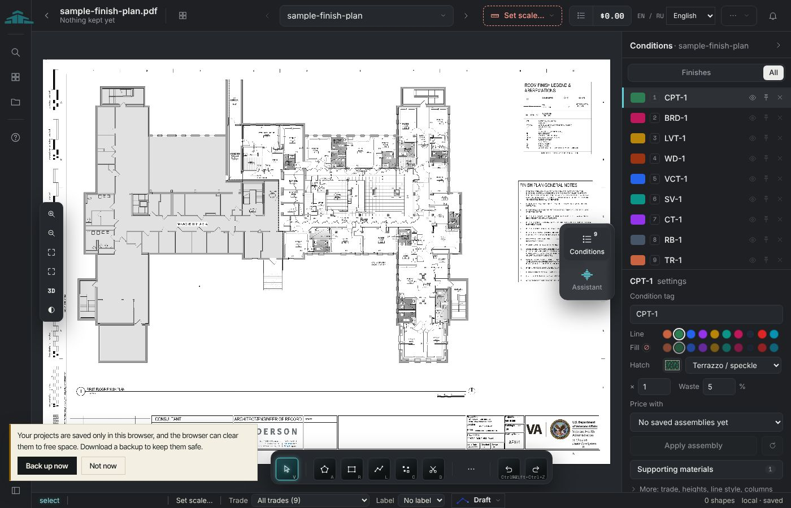
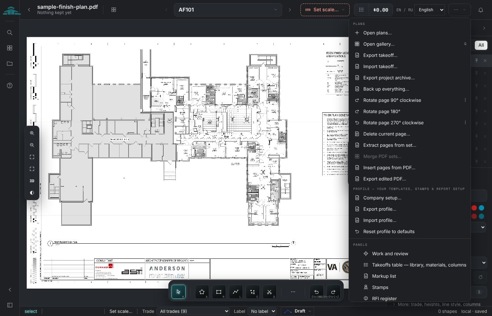
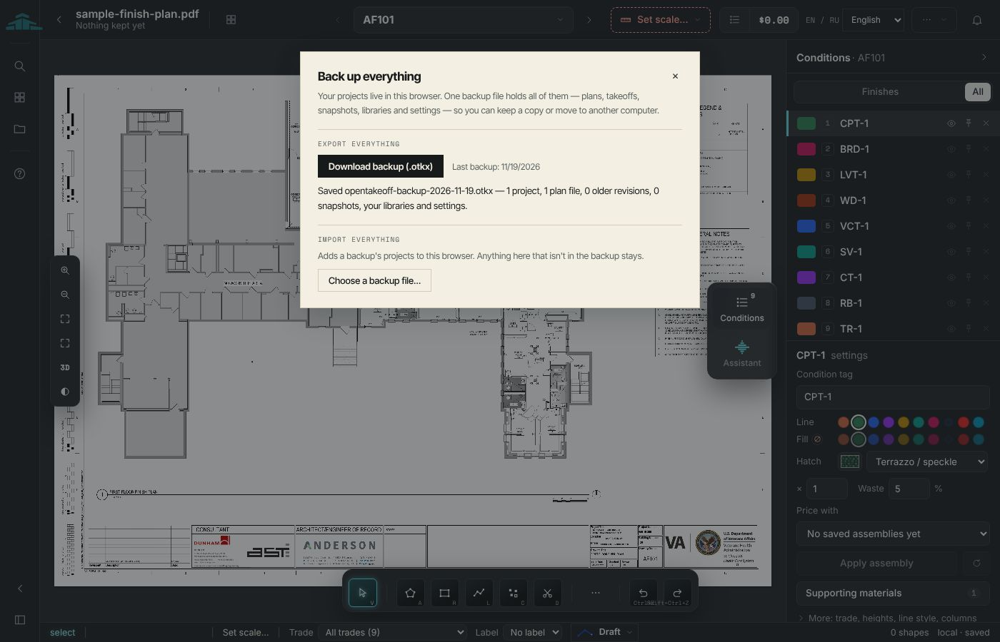
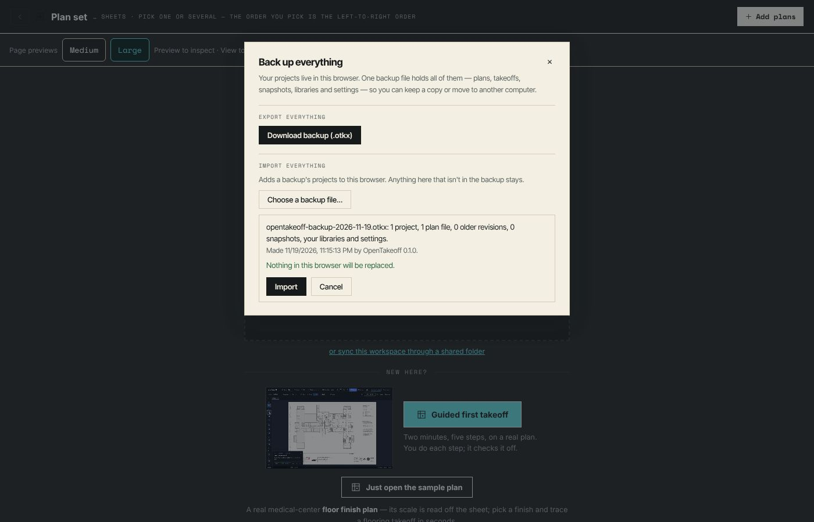
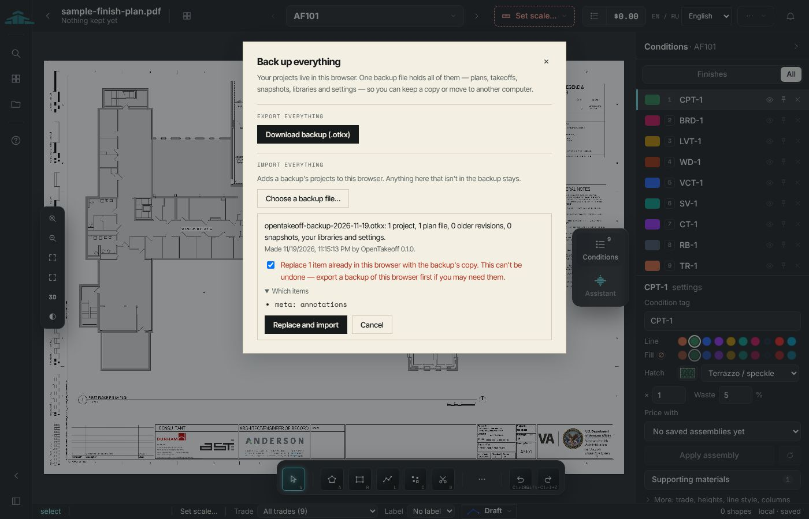

# Export everything — verification

Checked against a production build (`npm run build`, `vite preview`) in
headless Chromium (Playwright), with two separate browser contexts standing in
for two browsers, plus unit and round-trip tests on fake-indexeddb and a
streaming measurement in Node.

## Live (Chromium, production build)

`showSaveFilePicker` was removed in the page so the download path could be
captured; the file-on-disk path is not exercised by this run.

| Claim | Live result | ✓ |
|---|---|---|
| Persist is asked once on load and recorded | fresh browser: `opentakeoff_backup_state` = `{"persist":{"granted":false,"supported":true,…}}` (headless Chromium refuses persistence) | ✓ |
| No reminder with nothing to lose | fresh browser, no plan: reminder not shown | ✓ |
| Reminder once there is work | sample plan opened, reload: reminder shown (lower left) | ✓ |
| Back up now → one file | dialog → Download backup: `opentakeoff-backup-2026-11-19.otkx`, 1,180,400 bytes; dialog reads "1 project, 1 plan file, 0 older revisions, 0 snapshots, your libraries and settings" | ✓ |
| A backup quiets the reminder | after export: `last_backup` recorded; reload: reminder not shown | ✓ |
| File menu entry | top-right menu → **Back up everything…** opens the dialog | ✓ |
| Import into an empty browser | second context: "Nothing in this browser will be replaced." → Import → Reload: `pdfs` = `["sample-finish-plan.pdf"]`, the plan opens with its nine conditions | ✓ |
| Identical re-import asks nothing | same file again, nothing changed: no conflict | ✓ |
| Changed data is not replaced silently | edited the `annotations` record in browser B, re-import: "Replace 1 item…", **Which items** lists `meta: annotations`, **Replace and import** disabled until ticked (`disabled` true → false) | ✓ |
| Replace writes the backup's copy | after Replace and import: B's edit (`project_name: "Edited in browser B"`) is gone, the backup's record is back | ✓ |
| An edit just before export is in the backup | sample plan: CPT-1 waste 5 → 17 typed, then Download backup at once (file ready 145 ms after the click, inside the 700 ms autosave window): the backup's `annotations` record has `waste_pct: 17` | ✓ |
| Closing after an import reloads | import, then Escape: the page navigated (a marker set on `window` was gone) and the restored plan opened | ✓ |
| No page errors | `pageerror` listener on both contexts: none | ✓ |







## Tests

`web/test/browserExport.test.ts` (8 tests) and `web/test/backupStatus.test.ts`
(7 tests), all passing:

- **Round trip:** a seeded browser with two projects (`annotations` and
  `annotations:folder-xyz`), a plan revised twice (current rev 3, revisions 1
  and 2), a second plan, two snapshots, templates, materials, sheet pages, a sync record holding a `Date`, `undefined`, `NaN`,
  `Infinity` and a `$otkx` key, an OCR cache holding a `Float32Array` and an
  `ArrayBuffer`, plus ten localStorage keys. Exported, imported into a new
  empty IndexedDB, and every record of every store compared deep-equal (Blobs
  by bytes and type) with the original, except the two excluded records
  (thumbnail, folder handle). The six app keys come back; the AI key, the
  assistant link, the backup state and an unrelated key do not. The store's
  own readers then list both plans, the revision trail `[3, 2, 1]`, revision
  1's bytes, and project 2's conditions.
- **Manifest:** schema, version, counts, project keys, completeness; unknown
  schema and hollow manifests refused.
- **Encoder:** binary moved out, exact tags, a class instance refused.
- **Overwrite:** identical re-import has 0 conflicts; after changing one
  project and one plan, exactly those two conflict (the revision the change
  archived is new, not a conflict), apply without `overwrite` throws
  `ImportConflictError` and writes nothing, apply with it restores the backup.
- **Limits:** a byte budget leaves plans out, lists them with sizes and reason,
  keeps both project records, and what was written still imports; an entry
  budget of 8 holds the file to 8 entries.
- **Damage:** not a zip, a zip without a manifest, and one flipped byte inside
  a stored PDF are each refused before anything is written.
- **Reminder and persist:** every branch of the rule, dismissal, blocked
  storage, and `persist()` granted, denied, throwing, already granted (not
  asked again) and missing.

## Streaming

Two 200 MB plans in fake-indexeddb, exported to a sink that only counts bytes
(`node --expose-gc`, Node 22):

```
{"archive_MB":400,"chunks":67,"max_chunk_MB":8,"rss_before_MB":1078,"rss_peak_MB":931,"rss_growth_MB":-147,"seconds":1.52,"pdfs":2,"complete":true}
```

The largest chunk handed to the sink is 8 MB, and resident memory doesn't
grow during the export (the source PDFs themselves are in memory in this
harness, which is why the baseline is high).

## Commands

```bash
cd web
npm ci
node --import tsx --test test/browserExport.test.ts test/backupStatus.test.ts
npm run check
```

`npm run check` green on Node v24.22.3 (web suite: 3,854 tests, 3,850 pass, 0 fail, 4 skipped; bench passed; build and OCR dist checks pass). Also green: `npm run check --prefix protocol`, `npm run check:wiki --prefix mcp`, `npm run check:tool-count --prefix mcp`, `node scripts/check-doc-links.mjs`.

**Not exercised:** the `showSaveFilePicker` file-on-disk path (needs a person
at the picker), Firefox and Safari, and a real multi-gigabyte browser.
