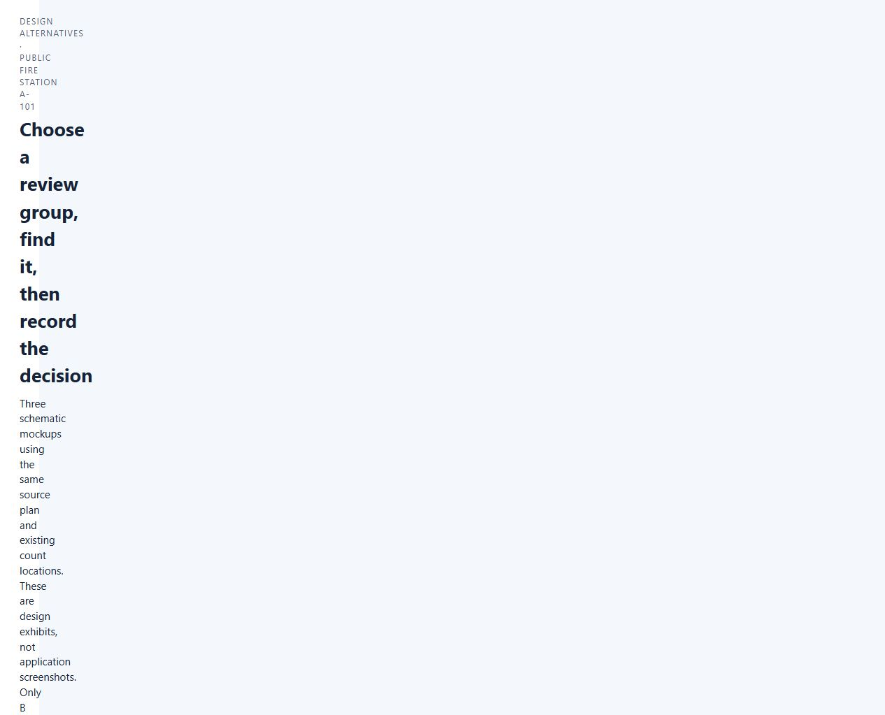

# Draft: feat(review): select, locate and review a measurement subset

Prepared on the contributor's fork. This document is not a posted PR.

## What and why

OpenTakeoff already supports accepting a whole proposed batch. This change lets
an estimator select a smaller group, see those measurements together on the
plan, and mark that group reviewed using the existing review and Undo behavior.

[Design options, public-plan recordings and detailed checks](public-review/README.md)
support the proposal. The verification summary and evidence links follow below.

This is a focused extension to the existing panel. No separate bulk-review issue
has been opened and no maintainer agreement is implied. The design is offered
for discussion; I can adjust the interaction or scope after that review. The
options/evidence format follows the feedback on [#660](https://github.com/Kentucky-ai/opentakeoff/pull/660#issuecomment-6998470824),
but this branch does not depend on or complete that PR.

## Contributor agreement

Agreement comment link: https://github.com/Kentucky-ai/opentakeoff/issues/659#issuecomment-6985194643

## How it was verified

- [x] `npm run check --prefix web`: typecheck, lint, tests, benchmark and build.
- [x] Protocol, tool-count, wiki and documentation-link gates pass locally.
- [x] The flow runs on public fire station A-101 and Illini landscape sheets;
  earlier evidence also covers bundled AF101.
- [x] Changelog, feature map, user guide and evidence are updated.
- [x] Actual browser exports after batch Undo and reopening match all 89
  measurement records, condition fields and source calibration exactly.

These are local results, not GitHub PR CI or human quantity approval. The
[check manifest](public-review/checks.json) identifies tested builds and commands.

## Evidence

[Full review package and reproduction steps](public-review/README.md).



Options A and C are schematic prototypes. B is implemented and recommended:
explicit membership and easy exclusions, using the existing review/Undo command.
The tradeoffs are extra selection actions and a smaller framing scale for widely
separated marks. Human preference and speed have not been measured.

| Check or scenario | Expected | Observed | Evidence |
|---|---|---|---|
| Three existing counts, one already reviewed | Review two, retain the prior decision | Matched; one Undo restores the batch | [Fork recording](public-review/after-flow.gif), [upstream recording](public-review/before-flow.gif) |
| Select all filtered beyond 50 visible rows | Select all 89 existing records across two sheets | 89 selection glyphs; 86 pending | [Two-sheet selection](public-review/07-89-across-two-sheets.jpg) |
| Counts, areas and lengths on a busy landscape sheet | Keep EA, SF and LF distinct | Matched | [Landscape selection](public-review/09-landscape-mixed-selection.jpg) |
| Save and reopen | IDs, geometry, quantities, decisions and calibration unchanged after Undo | Exact comparison passes twice | [After Undo](public-review/public.after-undo.takeoff.json), [after reopen](public-review/public.after-reopen.takeoff.json) |
| Responsive and keyboard behavior | Visible selection; Space toggles a row; narrow Show closes drawer | Matched | [Checks and screenshots](public-review/README.md#observed-checks) |

```sh
npm ci --prefix web
npm ci --prefix mcp
npm ci --prefix protocol
npm run check --prefix web
npm run check --prefix protocol
npm run check:tool-count --prefix mcp
npm run check:wiki --prefix mcp
node scripts/check-doc-links.mjs
node docs/evidence/bulk-select-review/verify-export.mjs docs/evidence/bulk-select-review/public-review/public.after-reopen.takeoff.json docs/evidence/bulk-select-review/public-review/public-sample.takeoff.json
```

## Notes for the reviewer

The **Work and review** panel adds row checkboxes, **Select all filtered**,
**Show selected on plan** and **Mark selected reviewed**. Only selected records
with an explicit pending state and usable source location change; one Undo
restores the batch. Previously reviewed and unselected records remain unchanged.

The change reuses the existing review command, count renderer and per-sheet
coordinates. It adds no persisted fields or MCP tools. Count rings, callout
quantities, trade suites and catalog integration remain separate.

Tested against upstream `8a31fb49d5a2c286c665017219073b0abe61695b` in two local
production builds. No public deployment is changed. The example reuses earlier
public OpenTakeoff measurements and labels three prior review flags as synthetic
QA setup. Source scales remain unconfirmed; this is a bounded UI sample, not a
complete takeoff or an independent counting benchmark. No private plans or
catalog data are included.

Stored vertices remain normalized per sheet. Selection framing maps them through
the existing rendered panel dimensions and offsets. Counts use the native
selected glyph; area and length cues are temporary outlines. Search/filter
changes clear selection. **Show selected on plan** uses the existing four-sheet
limit; larger selections must be inspected in smaller plan groups. The review
button can still act on the explicitly selected pending records.

The recordings demonstrate behavior, not measured estimator speed. Complete
new Russian translations, touch interaction and large-project performance remain
unverified. No marked-PDF renderer changes are included. Maintainers can review
the alternatives before this moves beyond draft.
