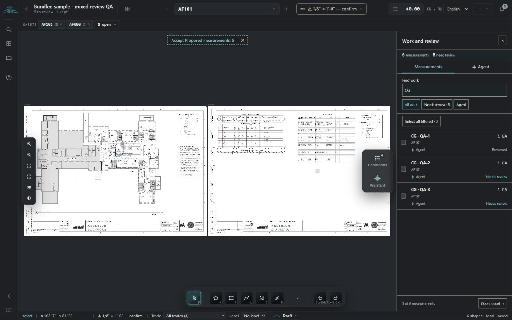
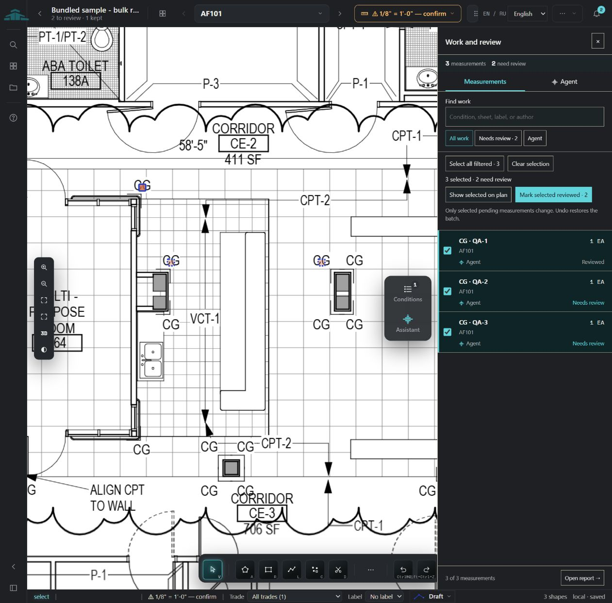
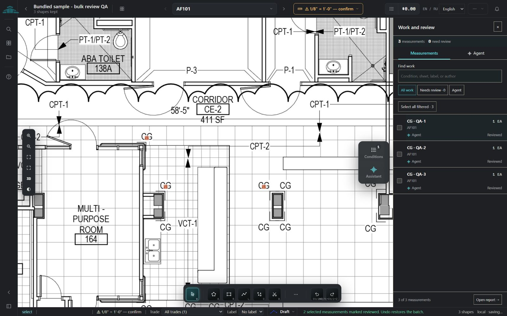
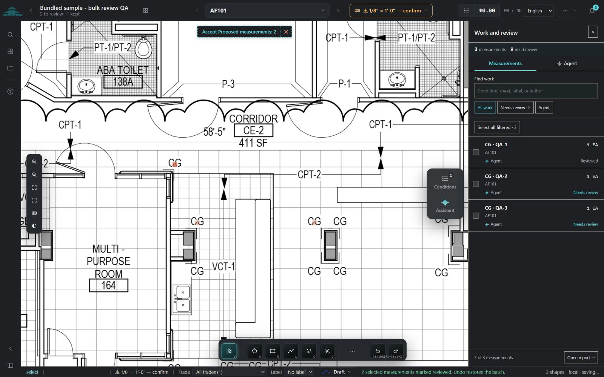
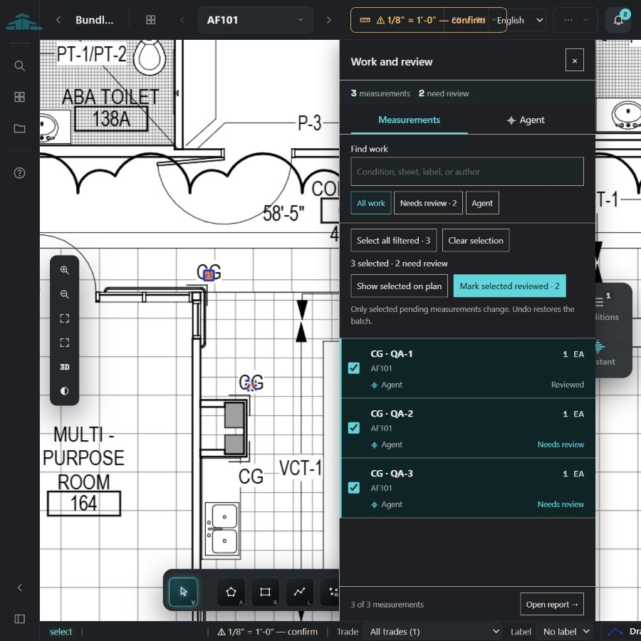
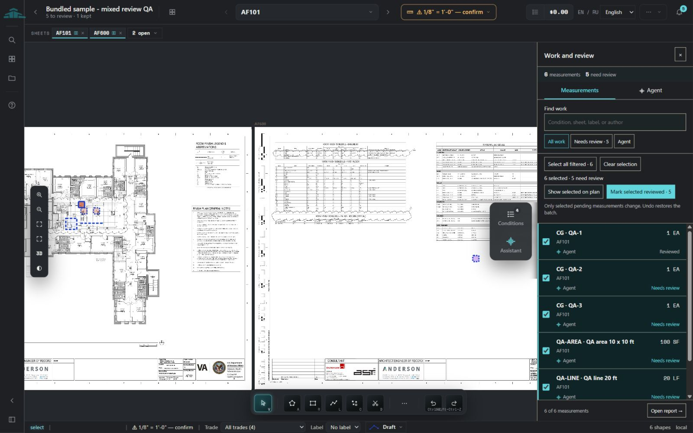
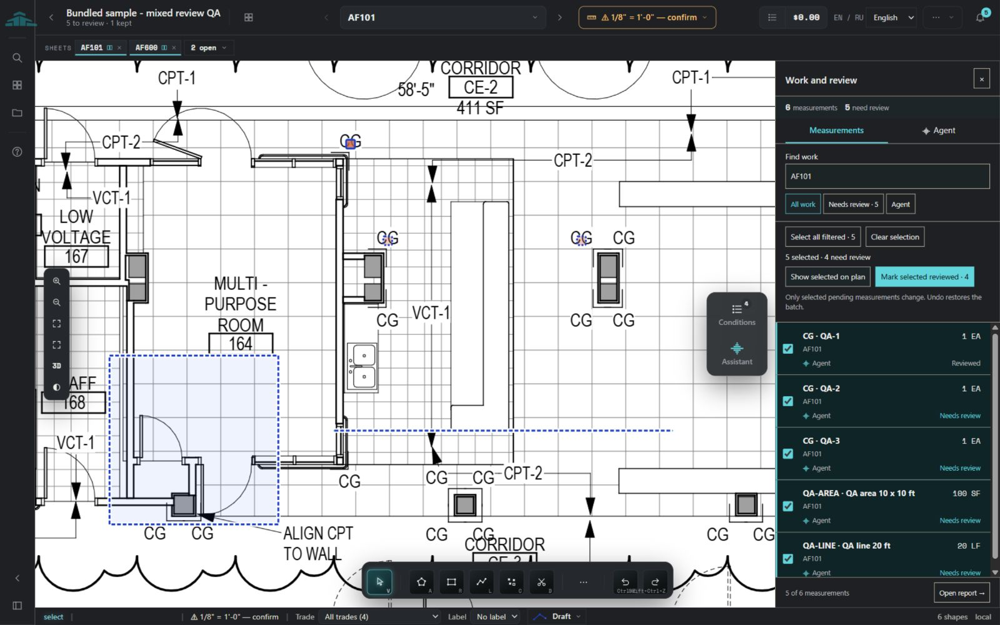
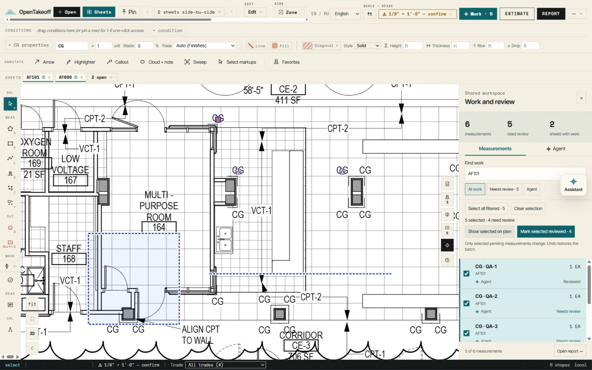

# Bulk selection and review—branch evidence

The branch now includes upstream main `8a31fb49d5a2c286c665017219073b0abe61695b`.
The original November 18 trial below started at `3add1846a974aebc8820fa53af9933f75251690a`.
It adds checkboxes, filtered selection, plan highlights and batch review to
**Work and review**, using the existing `review` command and one-step undo.
No persisted fields, MCP tools, callout records or dependencies on the separate
paper-space marker/locator branch are added.

**Latest review pass:** [Public-plan comparisons, three design alternatives,
recordings and exact 89-record export checks](public-review/README.md).
The [prepared PR description](PR-DRAFT.md) stays on this fork; no new PR is posted.

## Contribution readiness

The evidence package is prepared on the contributor's fork for review before a PR.
No issue or PR has been opened for this branch. The contributor chooses to submit
this focused extension to the existing review panel without a separate issue.
The upstream [contribution guide](../../../CONTRIBUTING.md#pull-requests--how-we-work)
still recommends issue-first agreement for larger changes and new canvas
interactions; this choice does not assert maintainer agreement or waive that
guidance. A maintainer can request discussion during review.

| Requirement | Evidence |
|---|---|
| One concern | Select, locate and review existing measurements; no catalog, trade suite or callout model |
| Required local gates | Refreshed web, protocol, tool-count, wiki and doc links; see [latest checks](public-review/checks.json) and [original checks](local-checks.json) |
| Visible surfaces and flow | [Three options and public-plan before/after recordings](public-review/README.md), plus the earlier bundled-plan trial below |
| Public source | Bundled sample, public fire station and cited public landscape sample; no new PDF, private project, catalog, prices or credentials committed |
| Documentation | Changelog, feature map, README and user guide updated |
| Contributor agreement | [Author's existing agreement](https://github.com/Kentucky-ai/opentakeoff/issues/659#issuecomment-6985194643); no new signature required |
| Reviewer limits | Coordinate spaces, deliberate limits and unverified work stated below |

Passing local gates is not green GitHub CI or maintainer approval. The workflow
runs on PRs and main pushes, so PR CI remains pending until a PR exists. Refresh
the base and rerun checks if upstream changes before submission.

## Reproduce the example

Use Node 24 and run from the repository root:

```sh
npm ci --prefix web
node docs/evidence/bulk-select-review/make-example.mjs /path/to/bulk-review-example.otk
npm run dev --prefix web -- --host 127.0.0.1 --port 5182 --strictPort
```

Open that address in a separate empty browser workspace. Click **Open plans**
and choose the archive. An archive replaces that origin's current project;
export an existing project first. Another tab on the same origin is not a
separate workspace.

The archive includes the repository's existing `demo/sample-finish-plan.pdf`.
The three CG points are deliberately selected printed callout anchors on AF101,
not a complete corner-guard takeoff or measured guard footprints. QA-1 starts
reviewed as synthetic preservation-test data; QA-2 and QA-3 start pending.

1. Open AF101, hide the Conditions panel and open **Work and review**.
2. Click **Select all filtered**. Expect three selected and two needing review.
3. Click **Show selected on plan**. Expect all three existing locations outlined.
4. Click **Mark selected reviewed**. Expect zero pending; QA-1 stays reviewed.
5. Click **Undo** once. Expect two pending and one reviewed.
6. Search `QA-2`, select and review it. Clear the search; QA-3 stays pending.
   Undo once to restore the baseline.
7. Reload, select all again, then **Everything else → Export takeoff…**.

```sh
node docs/evidence/bulk-select-review/verify-export.mjs /path/to/export.takeoff.json
# Recheck the actual saved browser export included with this evidence:
node docs/evidence/bulk-select-review/verify-export.mjs docs/evidence/bulk-select-review/sample.after-undo.takeoff.json
```

The verifier compares every measurement and condition field, including IDs,
geometry, quantities and review states. It also checks source calibration and
that temporary selection is absent from the export.

## Extended example and recording

Build the optional mixed-unit fixture and use a different local origin, such as
port 5183, to preserve the first workspace:

```sh
node docs/evidence/bulk-select-review/make-example.mjs /path/to/mixed-review-example.otk docs/evidence/bulk-select-review/mixed.takeoff.json
npm run dev --prefix web -- --host 127.0.0.1 --port 5183 --strictPort
```

This retains the same three CG anchors and adds clearly labeled synthetic UI
control geometry on the real bundled PDF: a 100 SF rectangle, a 20 LF line and
one count anchor on AF600. Those additions test navigation and unit handling;
they are not quantities inferred from the plan. The six records start with five
pending and one reviewed.

- Search `CG` to reproduce the recording: select three, show them, review the
  two pending entries and undo. The other three pending records stay pending.
- Clear the search and select all six. **Show selected on plan** opens both
  sheets and frames all six locations clear of the floating side tabs.
- Search `AF101` and select all five results to inspect count, area and line
  highlights at working zoom. EA, SF and LF remain separate.
- Clear the search, select all six, review five, then undo once. Reload to
  confirm five pending, one reviewed and unchanged displayed quantities.



This is a timed capture of the running browser, encoded as a GIF with the
original timing. It has 64 captured frames over 19.2 seconds; identical frames
are combined. [Recording metadata](recording.json) records the actions and hash.

## Observed results

Tested on 2026-11-18 in the Codex in-app browser (Chromium), local Vite builds on
ports 5182 and 5183. The initial trial covers desktop and narrow layouts; the
extended trial and recording use 1600 × 1000. Temporary viewport overrides were
reset afterward. No public hosted build was updated or tested for this branch.

| Check | Expected | Observed |
|---|---|---|
| Three-count selection | 3 native count outlines; 2 reviewable | Matched |
| Uncheck one | 2 outlines | Matched |
| Review and one Undo | Only pending entries change; original decision restored | Matched |
| Filtered QA-2 review | QA-3 remains pending | Matched |
| Change search | Checked selection clears | Matched |
| Reviewed-only selection | Review button disabled | Matched |
| Hidden condition | Selected work becomes visible | Matched |
| Narrow Show selected | Drawer closes; points framed | Matched |
| Original export after Undo | Exact records and calibration; no selection fields | Matched |
| Two-sheet selection | All 6 locations visible | Matched; rightmost marker clears side tabs by 25 px |
| Mixed working zoom | 100 SF area, 20 LF line and EA counts remain distinct | Matched |
| Mixed batch review and Undo | 5 pending → 0 → 5; 1 original decision retained | Matched |
| Reload extended fixture | 5 pending, 1 reviewed; same displayed quantities | Matched |
| Classic layout | Selection and framing work | Matched |
| Russian UI smoke | Selection and framing work | Matched; added labels retain partial English fallback |

The two-sheet trial caught an obscured outer marker. Framing now reserves the
actual floating side-tab width plus existing spacing-token clearance. The
measured browser bounds are in [cross-sheet-clearance.json](cross-sheet-clearance.json).

The native count's geometry, fill, selected stroke and dash match individual
selection. See [count-selection-parity.json](count-selection-parity.json).
This branch uses native rounded-square counts; it does not introduce plant rings.










Machine-readable observations: [original trial](validation.json),
[extended trial](extended-validation.json).

## Required checks

```sh
npm ci --prefix mcp
npm ci --prefix protocol
npm run check --prefix web
npm run check --prefix protocol
npm run check:tool-count --prefix mcp
npm run check:wiki --prefix mcp
node scripts/check-doc-links.mjs
```

All passed locally. The web gate includes typecheck, lint, 3,825 tests
(3,821 passed, 4 skipped, zero failures), benchmark, production build and OCR
distribution checks. Seven added selection tests cover stale IDs, native review
and undo, mixed units, selection beyond the first 50 rows, missing geometry,
sheet offsets, curves, holes and large vertex lists.

## Notes for the reviewer

- Vertices remain normalized per sheet. Framing maps them to rendered panel
  pixels with existing panel offsets and curve flattening. No geometry is edited.
- Selection is temporary. Counts inherit the native selected glyph; area and
  line outlines use existing UI colors. Selection does not represent plant spread.
- The existing four-sheet display limit applies. Larger selections show an
  explanation and require smaller groups for plan review.
- Only selected records with explicit `origin.reviewed === false` and usable
  source locations are reviewed. Legacy records without a review state stay
  untouched. A stored review decision does not prove quantity accuracy.
- Counts, areas, lines, two sheets and both layouts were exercised in the browser.
  Curves, holes and large groups have unit coverage, not a browser performance
  benchmark. Russian strings use the existing fallback; a full translation is
  unverified. See [Russian UI capture](12-russian-fallback.jpg).
- The exact-record export check passed for the original three-count fixture.
  An additional six-record export comparison is unverified: the app displayed
  its export receipt, but the in-app browser download stopped and no file was
  recovered. Reloaded UI values and command tests passed; they do not replace
  that exact export comparison. The [November 20 public-plan trial](public-review/README.md)
  now verifies all 89 records across counts, areas and lengths both after Undo
  and after reopening. That supplies mixed-unit persistence evidence without
  claiming the old six-record download was recovered.
- No MCP or persisted-format changes, required merge order, new issue or new PR.
