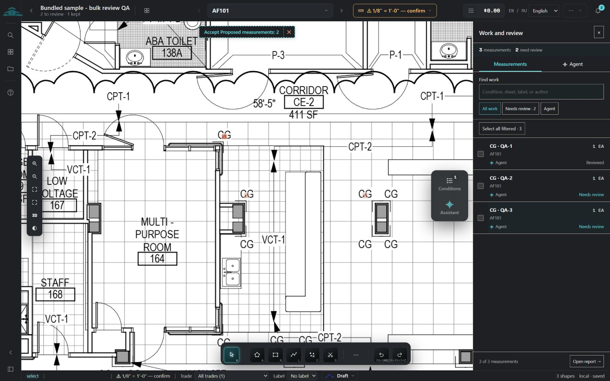

# Bulk selection and review — branch evidence

This branch starts at upstream main `3add1846a974aebc8820fa53af9933f75251690a`.
It adds checkboxes, filtered selection, a plan highlight and a batch review button
to **Work and review**. Review and undo use the existing `review` shape command.
There is no persistence change, new MCP tool, callout record or dependency on the
paper-space marker/locator branch. This is a fork review branch; no PR is opened.

## Reproduce the example

With Node 24, run from the repository root:

```sh
npm ci --prefix web
node docs/evidence/bulk-select-review/make-example.mjs /path/to/bulk-review-example.otk
npm run dev --prefix web -- --host 127.0.0.1 --port 5182 --strictPort
```

Open that local address in a separate empty browser workspace, then **Open plans**
and choose the generated `.otk`. Opening an archive replaces that origin's current
project, so export any existing project first. Another tab on the same origin is
not an independent workspace.

The example carries the repository's existing `demo/sample-finish-plan.pdf` and
three deliberately selected CG callout anchors on AF101. It is a limited UI
fixture, not a full corner-guard takeoff or an inferred guard footprint. QA-1's
reviewed state is synthetic test data; QA-2 and QA-3 start pending. No customer
plan, catalog, prices or credentials are included.

1. Open AF101, hide the Conditions panel and open **Work and review**.
2. Click **Select all filtered**: expect three checked rows and two needing review.
3. Click **Show selected on plan**: expect all three existing locations outlined.
4. Click **Mark selected reviewed**: expect zero pending; the original reviewed
   entry remains reviewed. Click **Undo** once: expect two pending and one reviewed.
5. Search `QA-2`, select the filtered result, review it, then clear the search.
   QA-3 must still need review. Undo once to restore the baseline.
6. Reload and confirm two pending and one reviewed. Select all again, then use
   **Everything else → Export takeoff…** while the selection is still active.
7. Check the exported file:

```sh
node docs/evidence/bulk-select-review/verify-export.mjs /path/to/export.takeoff.json
```

This compares full measurement and condition records, including IDs, geometry,
quantity and review state. It also compares the original calibration fields and
checks that transient selection was not exported.

## Observed results

Tested 2026-11-18 in the Codex in-app browser (Chromium) against the local Vite
build at `http://127.0.0.1:5182/`, at 1600 × 1000, 900 × 900 and the default
1280 × 720 viewport. This does not update or verify the public hosted build.

| Check | Expected | Observed |
|---|---|---|
| Select all | 3 outlines, 2 reviewable | 3 outlines, 2 reviewable |
| Uncheck one | 2 outlines | 2 outlines |
| Batch review | 0 pending; original decision retained | Matched |
| One Undo | 2 pending, 1 reviewed | Matched |
| Review filtered QA-2 | QA-3 remains pending | Matched |
| Change search | Clear checked selection | Matched |
| Select reviewed QA-1 only | Review button disabled | Matched |
| Select an explicitly hidden condition | Reveal it | Matched |
| Narrow Show selected | Close drawer and frame all points | Matched |
| Reload | Preserve decisions | Matched |
| Export after Undo | Exact original records; no selection fields | Matched |

Machine-readable observations are in [validation.json](validation.json).

The count-shape correction was checked after a full browser reload. The pending
count's geometry, fill, selected stroke and dash match exactly between individual
and bulk selection; all three bulk markers use native rectangles. See the actual
rendered attributes in [count-selection-parity.json](count-selection-parity.json).
No review action was performed for this visual correction. Updated screenshots
cover the 1600 × 1000 desktop, 900 × 900 panel and 1261 × 1243 default viewport.




## Checks

```sh
npm ci --prefix mcp
npm ci --prefix protocol
npm run check --prefix web
npm run check --prefix protocol
npm run check:tool-count --prefix mcp
npm run check:wiki --prefix mcp
node scripts/check-doc-links.mjs
```

All passed locally. The web gate includes typecheck, lint, 3,825 tests
(3,821 passed, 4 skipped, zero failures), benchmark, production build and OCR
distribution checks. Seven new selection tests cover stale IDs, native review
and undo, mixed quantity types, selection beyond the first 50 rows, missing
geometry, multi-sheet offsets, curves, holes and large vertex lists.

## Reviewer notes and remaining checks

- Stored vertices remain normalized per sheet. Framing and SVG highlights map
  them to rendered panel pixels, with existing panel offsets and curve flattening.
- Selection is temporary. Counts use the native count glyph's selected appearance
  for both individual and bulk selection. This branch's native count is a rounded
  square; there is no separate circular overlay or marker geometry definition.
  Selection does not change the saved marker or represent plant spread.
- **Show selected on plan** uses the existing four-sheet display limit. Selections
  beyond that limit show an explanation; use smaller groups for plan review.
- Only selected records with explicit `origin.reviewed === false` and a usable
  source location are bulk reviewed. Legacy records with no review state stay
  untouched. Review status remains a decision, not proof of quantity accuracy.
- The browser evidence covers counts on one sheet. Multi-sheet navigation,
  mixed area/length/count rendering, alternate layouts and Russian UI remain
  unverified in the browser. Corresponding geometry and selection helpers are
  unit-tested; the existing Russian fallback strings have not been translated.
- Before a PR: capture the contribution guide's short flow recording, extend the
  browser checks above, and rebase/recheck against the then-current main.
