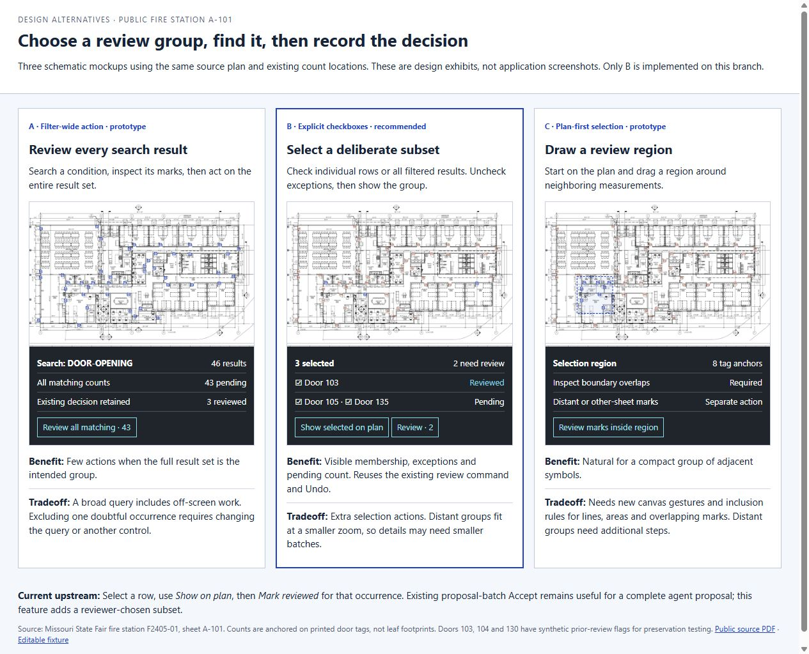
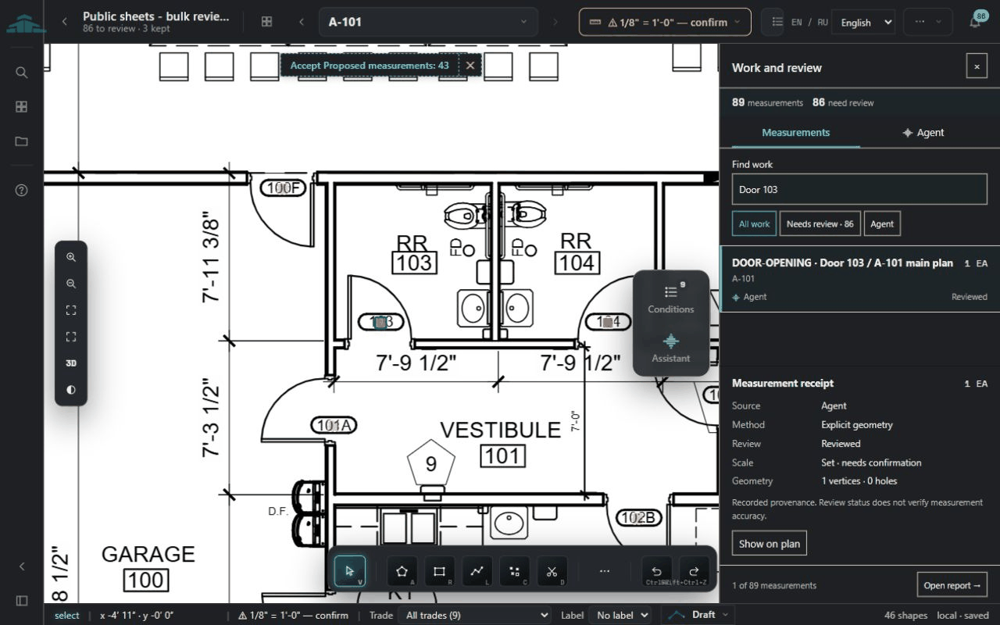
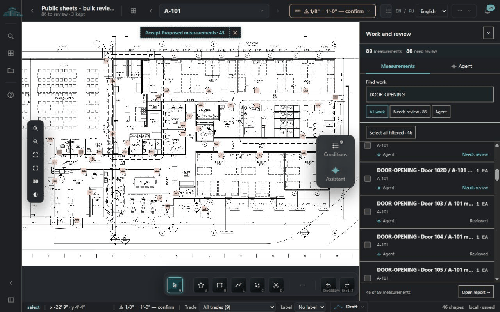
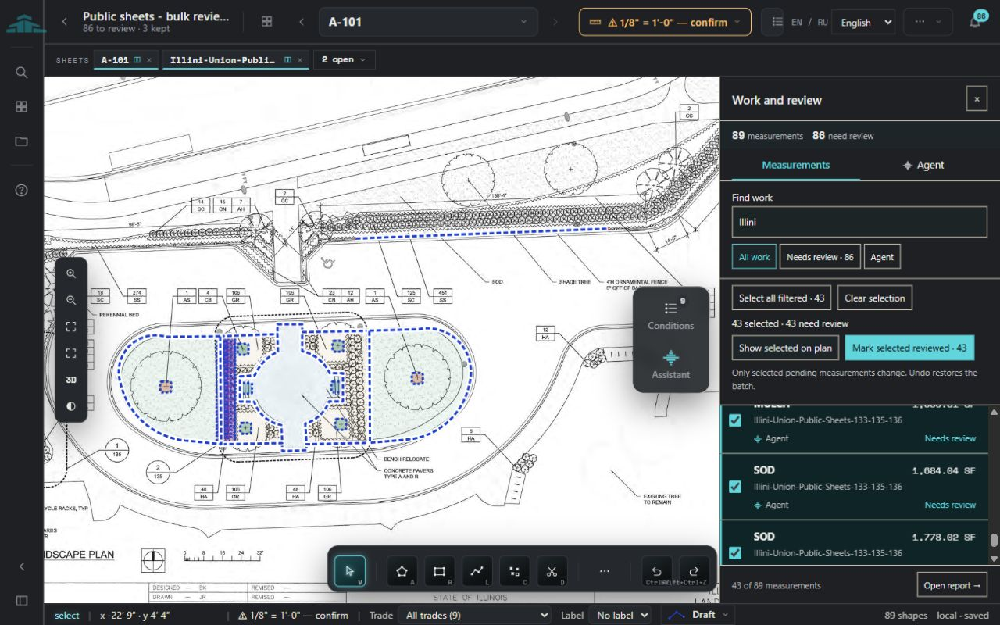

# Bulk review on public plans

**Latest follow-up:** [Inspect one measurement without losing the checked group](inspect-group/README.md).
It includes the reproduced selection-loss bug, the fix, new public-plan recordings,
exact export comparisons and checks for application commit
`e7b317099c88375772857140a6fd1f39a9173fc0`.

The original comparison below uses unchanged upstream `8a31fb49d5a2c286c665017219073b0abe61695b`
with the bulk-review branch at application commit
`b55ac6e02394e9cd8a363d22063a548322d9768c`. These original captures predate the
inspection follow-up above. Both are local production builds, tested
November 20, 2026 in the Windows ChatGPT in-app browser (Chromium), on
`127.0.0.1:5193` and `127.0.0.1:5192` respectively. The public hosted application
was not changed or used as an unidentified baseline.

The branch adds a reviewer-chosen selection to **Work and review**. It does not
add count rings, callout quantity records, landscape trades or catalog lookup.
Those remain separate work. No new MCP tool or persisted field is required.

## The review task

An estimator auditing a large count needs to find a deliberate group on the
sheet, exclude doubtful occurrences and record a decision without changing
previous decisions. Upstream supports individual row review and acceptance of
a whole agent proposal batch. It does not provide this arbitrary checked subset
in **Work and review**.

The public fire station example contains 46 tagged hinged openings. The small
comparison task uses Door 103, nearby Door 105 and distant Door 135. Door 103
already has a QA review flag. The reviewer finds the three locations, reviews
the two pending occurrences and reverses the decision. The larger trial selects
all 89 existing measurements across the fire station and landscape sheets.

For a 300-item review, the intended workflow is to search a condition or sheet,
select a manageable group, inspect it on the plan, uncheck exceptions, then
review that group. This trial does **not** claim 300 independently counted items,
measured human review speed or verified estimator preference. Widening the
selection to an entire set can make details too small; smaller groups remain
necessary for close inspection.

## Three options and the recommendation



The [HTML exhibit](options.html) uses the existing public coordinates. It is a
mockup, not an application screenshot. Only option B is implemented on the branch.

| Option | Effect on the task | Tradeoff |
|---|---|---|
| A: Review all filtered results | One action covers the whole search result | Broad queries can include off-screen work; exceptions need another control or query |
| B: Explicit checkboxes, select filtered, show selected | Membership and pending count are visible; exceptions can be unchecked | Extra selection actions; distant groups fit at a smaller zoom |
| C: Draw a region on the plan | Nearby marks can be chosen spatially | New gestures and rules for boundary overlaps, areas, lengths and other sheets |

**Recommend B.** It extends the existing review panel and existing review/Undo
command. It does not require a new canvas gesture or guess which overlapping
measurements belong to a region. This favors clear membership and a small code
change over the fewest possible actions. Maintainer agreement is still pending.

## Actual application recordings

The same task uses the same 89 IDs, geometry, quantities and initial review-state
values in both builds. Three prior QA decisions are set on 103, 104 and 130;
105 and 135 start pending. The upstream setup creates its two additional QA
flags through the UI, so their acceptance timestamps differ from the fork's.
This comparison concerns navigation and review behavior, not timestamp equality
between independently prepared browser origins.

| Unchanged upstream | Fork branch |
|---|---|
|  |  |
| Locate and review each pending occurrence; two Undo actions | Show the selected group; review its two pending entries; one Undo |

These are actual browser screenshots sampled during UI actions and encoded with
their original elapsed timing, not simulated application frames. They are about
11.0 and 7.8 seconds long; these durations are **not a speed benchmark**. There
is no human reading/decision time in the automated sequence. Capture metadata:
[upstream](before-flow-recording.json), [fork](after-flow-recording.json).

## Observed checks

| Check | Expected | Observed | Evidence |
|---|---|---|---|
| Three selected counts | 3 selected, 2 pending; existing decision stays | Matched | [Selected group](03-three-selected.jpg) |
| Review subset | Pending total 86 → 84; unrelated entries stay | Matched | [Reviewed](04-two-reviewed.jpg) |
| One Undo | 84 → 86; three prior decisions retained | Matched | [Undone](05-batch-undone.jpg), exact export below |
| Entire door condition | 46 selected, 43 pending | 46 selected glyphs | [All door counts](06-all-46-counts.jpg) |
| Search change | Checked selection clears | 0 selected glyphs | [Validation](validation.json) |
| Select beyond the display page | 89 selected despite 50 initially rendered rows | 89 selected glyphs across two measured sheets | [Two-sheet view](07-89-across-two-sheets.jpg) |
| Mixed batch and Undo | 86 pending → 0 → 86; prior decisions unchanged | Matched | [Batch result](08-all-reviewed.jpg), exact export |
| Landscape context | 37 EA records, 5 area records and 1 length record remain distinct | Matched | [Mixed selection](09-landscape-mixed-selection.jpg), [29 HA occurrences](10-landscape-29-counts.jpg) |
| Conflicting trade view | Selecting hidden HA work reveals it | Roofing filter returns to All; 29 glyphs | [Validation](validation.json) |
| Reviewed-only selection | Review button disabled | Matched for Door 103 | [Validation](validation.json) |
| Keyboard selection | Space checks and unchecks one row | 1 selected → 0 | [Validation](validation.json) |
| Narrow window | Show selected closes drawer and retains highlights | 29 glyphs; drawer closed | [Narrow plan](12-narrow-plan.jpg) |
| Classic and light theme | Controls and outlines remain usable | Exercised | [Light classic](13-light-classic-landscape.jpg), [Dark classic](14-dark-classic-selection.jpg) |
| Save and reopen | Exact measurements, condition fields and calibration; no saved selection | Passed both comparisons | [Export after Undo](public.after-undo.takeoff.json), [Export after reopen](public.after-reopen.takeoff.json) |



Desktop recordings use 1280 × 800. The narrow check uses 760 × 900. Temporary
viewport overrides are reset after testing. The final application console has
no captured error messages. Earlier import/activation attempts stalled in the
browser automation; the recordings above are the completed runs. The fixture
retains three explicit QA decisions from setup. They are not estimator approval.

## Source and quantity basis

The [source manifest](source-manifest.json) records PDF hashes and QA state.
These fixtures reuse public measurements from earlier OpenTakeoff MCP trials;
this pass does not recount them or claim independent measurement accuracy.
The original source remarks describe the initial all-pending takeoff. The QA
review flags in this fixture are separate test setup.

| Public drawing | Scope and limitations |
|---|---|
| [Missouri State Fair fire station F2405-01](https://oa.mo.gov/sites/default/files/bid-opportunities/_F2405-01Final%20Bid%20Plans.pdf), A-101, 09/19/2025 | 46 tagged hinged openings on the main floor plan. One EA per tag; marker at the tag center, not the leaf midpoint. Enlarged duplicates, overhead/serving tags and untagged equipment/cubicles excluded. [Tag/ID ledger](fire-station-source-ledger.json). The PDF is already in `demo/public-sheets/`. |
| [Illini Union landscape public plan segment](https://apps.dot.illinois.gov/eplan/desenv/072916/097-91539/PLANS/PL-91539-097-101-200.pdf), printed 133, 135 and 136 | 43 measured records on 133; 135 and 136 provide supporting details/schedule. 2 AS, 4 CB, 29 selected HA occurrences and 2 relocated benches; pavers 1,224.60 SF, mulch 1,832.50 SF, gross sod 3,462.06 SF, bounded fence 107.34 LF. [Tracing ledger](landscape-source-ledger.json). No guessed curb quantity. |

The landscape source is a reduced raster sheet. The 29 HA occurrences are a
bounded sample, not the printed bed quantity of 48 or schedule total of 137.
Gross sod does not deduct mulch rings. Some curves are approximate. Calibration
is unconfirmed in both sources. This is a UI-review fixture, not a completed bid.
EA, SF and LF are never added into one quantity, and printed callout quantities
are not inserted as individual count locations.

## Reproduce the public example

Use Node 24. Download the linked Illini PDF segment to an external working
folder. Python with `pypdf==6.21.4` reproduces the cited extraction byte for byte:

```sh
python docs/evidence/bulk-select-review/public-review/extract-landscape.py /path/to/PL-91539-097-101-200.pdf /path/to/Illini-Union-Public-Sheets-133-135-136.pdf
npm ci --prefix web
node docs/evidence/bulk-select-review/public-review/make-public-example.mjs /path/to/Illini-Union-Public-Sheets-133-135-136.pdf /path/to/Public-bulk-review.otk
npm run dev --prefix web -- --host 127.0.0.1 --port 5192 --strictPort
```

Open the local address in a genuinely separate empty workspace, choose **Open
plans**, and select `Public-bulk-review.otk`. The archive contains both PDFs and
the editable takeoff. It replaces that origin's current project; export any
existing project first. Another tab on the same origin shares the workspace.
Open A-101 from the gallery. If a background browser pauses PDF rendering,
activate the tab and wait for the sheet to render before locating measurements.

1. Hide Conditions, open **Work and review**, and search `DOOR-OPENING`.
2. Check 103, 105 and 135. Expect three selected and two needing review.
3. Click **Show selected on plan**, then **Mark selected reviewed · 2**.
4. Check the pending total changed from 86 to 84. Click **Undo** once; expect 86.
5. Clear the search. **Select all filtered · 89** includes rows beyond the first
   50. Show the selection; expect two sheets. Review 86, verify zero pending,
   then Undo once and verify 86 again.
6. Search `Illini` to inspect 43 mixed-unit records, or `HA` for 29 plant counts.
7. Export while the group is selected. Reload, wait for the saved project to
   load, and export again. Compare both files with the fixture:

```sh
node docs/evidence/bulk-select-review/verify-export.mjs /path/to/export.takeoff.json docs/evidence/bulk-select-review/public-review/public-sample.takeoff.json
# The actual saved exports included here also pass:
node docs/evidence/bulk-select-review/verify-export.mjs docs/evidence/bulk-select-review/public-review/public.after-undo.takeoff.json docs/evidence/bulk-select-review/public-review/public-sample.takeoff.json
node docs/evidence/bulk-select-review/verify-export.mjs docs/evidence/bulk-select-review/public-review/public.after-reopen.takeoff.json docs/evidence/bulk-select-review/public-review/public-sample.takeoff.json
```

The verifier compares every measurement and condition field, source calibration
and absence of temporary selection in the export. App-generated view fields,
such as the sheet currently open, are not required to match the starting view.

For the baseline, check out the upstream SHA above in a separate directory,
install its locked web dependencies and serve it on a different port. Load the
same archive. Repeat the three-door task with the individual receipt's **Show
on plan** and **Mark reviewed**, then Undo twice. Keep the projects on separate
origins; the recordings switch between those origins, not between projects that
share one browser database.

## Gates and review limits

[Check results and build hashes](checks.json): web typecheck, lint, 3,846 tests
(3,842 pass, 4 skip, zero fail), benchmark, build and OCR distribution check;
protocol, tool count, wiki and documentation links all pass locally. Commands
are the same as the [parent evidence page](../README.md#required-checks).
There is no new PR and therefore no new GitHub PR check run.

- The renderer uses normalized per-sheet vertices and existing panel offsets.
  Framing and outlines are temporary; neither changes stored geometry.
- Counts use the existing selected count glyph. This does not implement the
  rings or locator design alternatives discussed in PR #660.
- **Show selected on plan** has the existing four-sheet display limit. For a
  larger selection, its button is disabled with an explanation; the review
  action still concerns the explicitly selected pending records. Review the
  sheets in smaller groups when plan inspection is needed.
- Missing source locations and legacy records without explicit pending state
  are not bulk reviewed. Curves, holes, stale IDs and large vertex arrays have
  command/helper tests; this is not a large-project performance study.
- Selection is not part of the exported takeoff. No marked-PDF renderer is
  changed; a new marked-PDF visual comparison is not claimed by this package.
- The prior bundled AF101 trial remains in the parent evidence page. Its
  three-record exact export passes; the new 89-record mixed-unit export check
  supplies the stronger persistence evidence missing from the old six-record
  browser trial.
- Human preference, estimator reading speed, touch devices and complete new
  Russian translations remain unverified. Existing fallback behavior is
  documented in the earlier Russian UI smoke check.
- Maintainers still choose the interaction. This fork preparation does not
  mark #660 ready, close a discussion, publish another PR, or deploy anything.
