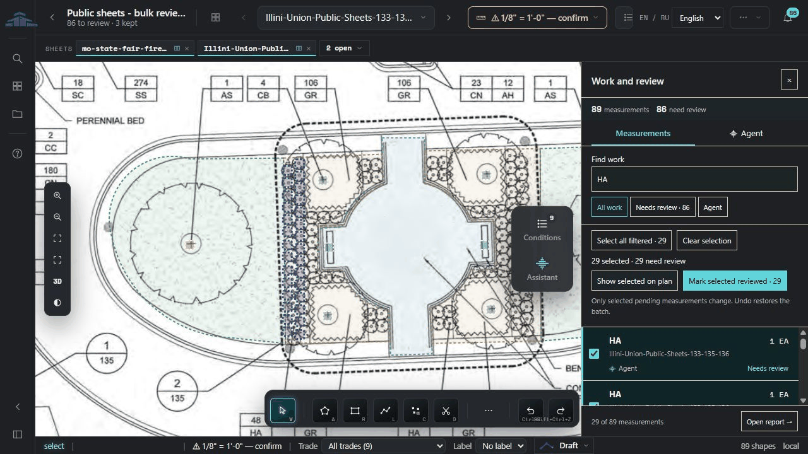
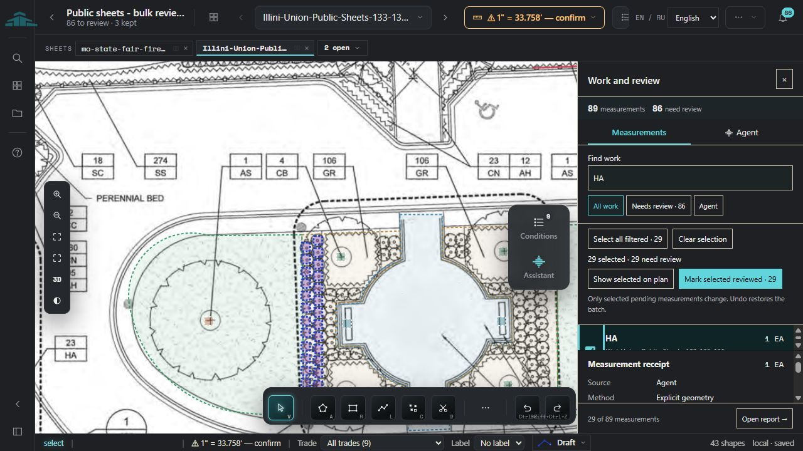

# Inspect one measurement without losing the group

Opening one measurement used to clear every checkbox in the review group. The
fix keeps inspection and checkbox membership independent. **Show selected on
plan** closes the individual receipt and returns to the checked group. No new
controls, measurement fields or MCP tools are added.

Tested November 20, 2026 in the Windows ChatGPT in-app browser (Chromium), using
the local production build at `127.0.0.1:5192`. Before:
`ddae679e9c2d6441c35ed1b4643975908a92ca19`; after:
`e7b317099c88375772857140a6fd1f39a9173fc0`. The before application's code is
unchanged from the original bulk-review evidence. [Build hashes and checks](checks.json)
identify both bundles. The hosted app and PR #660 are unchanged.

## Public-plan regression

The existing public sample contains 89 measurements, with 86 pending and three
prior QA review decisions. It uses the [public Illini Union landscape sheets](https://apps.dot.illinois.gov/eplan/desenv/072916/097-91539/PLANS/PL-91539-097-101-200.pdf)
and the [Missouri fire station A-101](https://oa.mo.gov/sites/default/files/bid-opportunities/_F2405-01Final%20Bid%20Plans.pdf).
[Source and quantity limits](../README.md#source-and-quantity-basis) still apply:
the 29 HA occurrences are a partial sample, scales remain unconfirmed, and the
three prior flags are QA setup. This pass does not recount or approve a bid.

| Before | After |
|---|---|
|  |  |
| 29 checked → open one row → 0 checked | 29 checked → inspect and locate one → 29 checked → return to the group |

These recordings are actual browser captures with their original elapsed
timing. They demonstrate behavior, not human review speed. Capture metadata:
[before](before-inspect-recording.json), [after](after-inspect-recording.json).



## Checks and outcomes

| Action | Observed |
|---|---|
| Open the first HA row; click its receipt's **Show on plan** | All 29 remain checked |
| Click **Show selected on plan** | Group framed; individual receipt closes; 29 remain checked |
| Uncheck the first HA, then inspect that unchecked row | 28 remain checked; inspection does not add the exception |
| Click another HA directly on the plan | Receipt switches to HA row 16; the same 28 remain checked |
| Review that checked group | Only those 28 pending records change; project pending total 86 → 58 |
| Undo once | All 89 records return exactly to the baseline; 86 pending and three prior decisions retained |
| Keep two AS plants checked, inspect reviewed Door 103 on A-101, then return | Two AS remain checked throughout; the correct sheet opens each way |
| Inspect an AS at 760 × 900, then reopen the drawer | Drawer closes to show the plan; both AS remain checked |
| Clear selection or change the search | Checked membership clears deliberately |
| Save and reopen | All records, conditions and calibration match; transient selection is absent |

[Unchecked exception](after-unchecked-inspection.jpg),
[cross-sheet inspection](after-cross-sheet-inspection.jpg),
[narrow plan](after-narrow-plan.jpg), [reopened narrow drawer](after-narrow-selection.jpg).
The [observations](observations.json) record the selected IDs and checkbox counts.
No browser console errors were captured.

## Reproduce and verify

1. Build the branch and load the [same public sample](../README.md#reproduce-the-public-example)
   on a separate local origin. Export the starting takeoff before testing.
2. Open **Work and review**, search `HA`, click **Select all filtered**, then
   **Show selected on plan**. There are 29 HA records in this sample.
3. Open the first HA row, click **Show on plan**, then **Show selected on plan**.
   The group stays at 29; returning to the group closes the receipt.
4. Uncheck the first row and inspect it again. The group stays at 28. Inspecting
   an unchecked occurrence does not change checkbox membership.
5. Export after inspection, review the group, export, Undo once and export again.
   Reload and export once more. On this QA fixture, review changes 28 pending
   flags; Undo restores them. The three existing decisions stay untouched.
6. For the cross-sheet check, clear the search, check the two AS plants and open
   Door 103 on A-101. Click **Show selected on plan** to return to the plants.

The checked-in files are actual UI exports. From the repository root:

```sh
node docs/evidence/bulk-select-review/public-review/inspect-group/verify-inspection.mjs
```

The verifier compares every measurement and condition, the source calibration,
the exact review subset and absence of persisted selection. It passes for
[inspection](after-inspection.takeoff.json), [review](after-review.takeoff.json),
[Undo](after-undo.takeoff.json) and [reopening](after-reopen.takeoff.json), against
the [saved browser baseline](before.takeoff.json).

Web typecheck, lint, tests (3,842 pass, four skip, zero fail), benchmark, build,
protocol, tool-count, wiki and doc-link checks pass locally; [logs](checks.txt).
This is a view-state regression exercised in the actual app; the existing
selection/review-command tests still pass. No new helper-only test is claimed
to prove the browser interaction.

## Review limits

The fix preserves native single-measurement appearance and navigation; it does
not add a new focus halo or change the ring/locator design in #660. Checking or
unchecking a box still exits individual inspection. Search/filter changes,
explicit clearing, completed batch review and project reload clear the group.
The existing four-sheet framing limit remains.

At 760 px the existing header's scale and language controls overlap; the drawer
retention test does not establish full mobile usability. Touch interaction,
human preference and review speed remain unverified. No private drawing or
catalog data is included. No new PR is opened.
