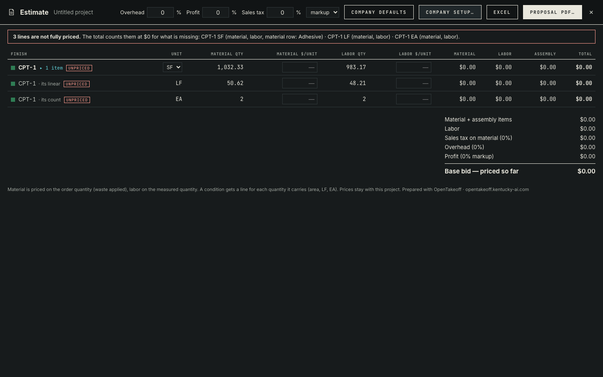
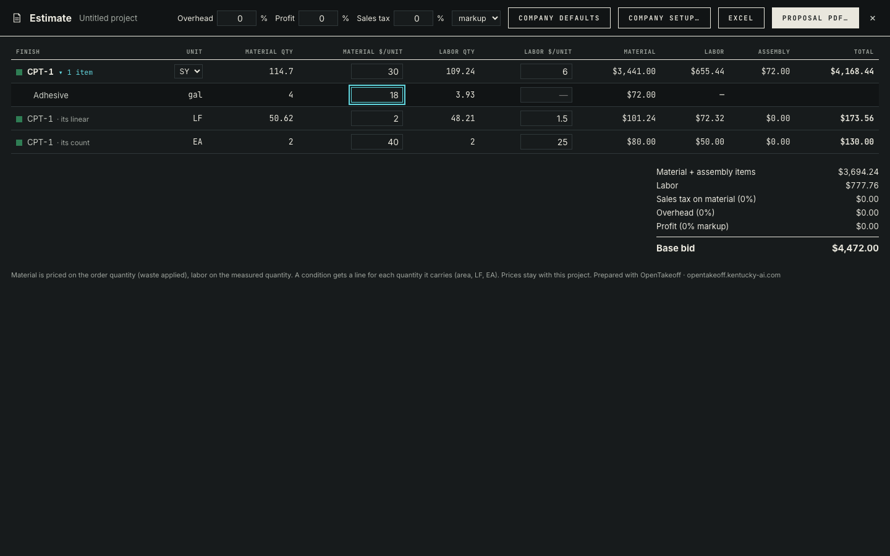
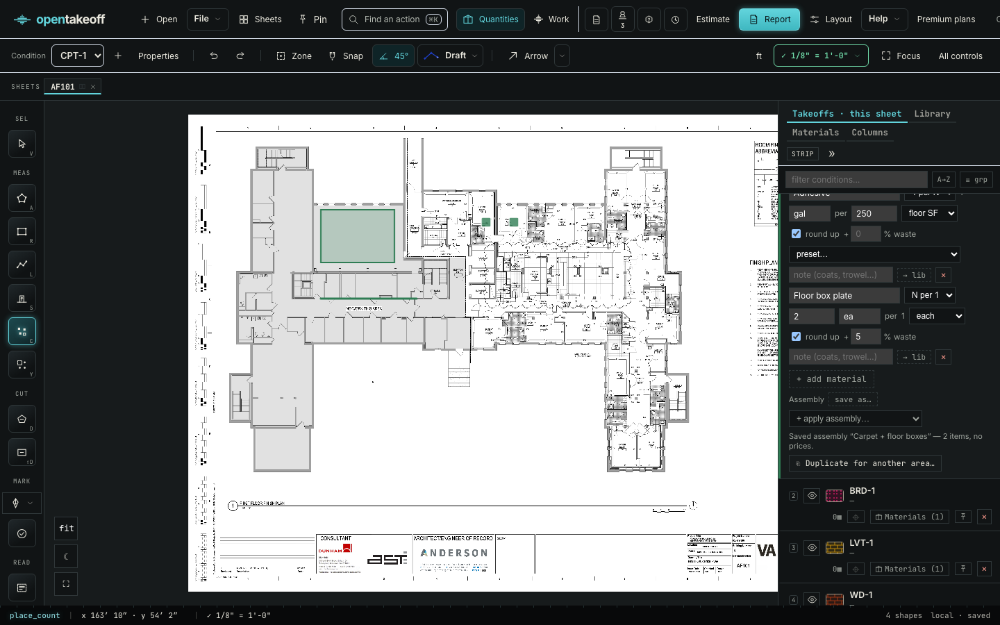
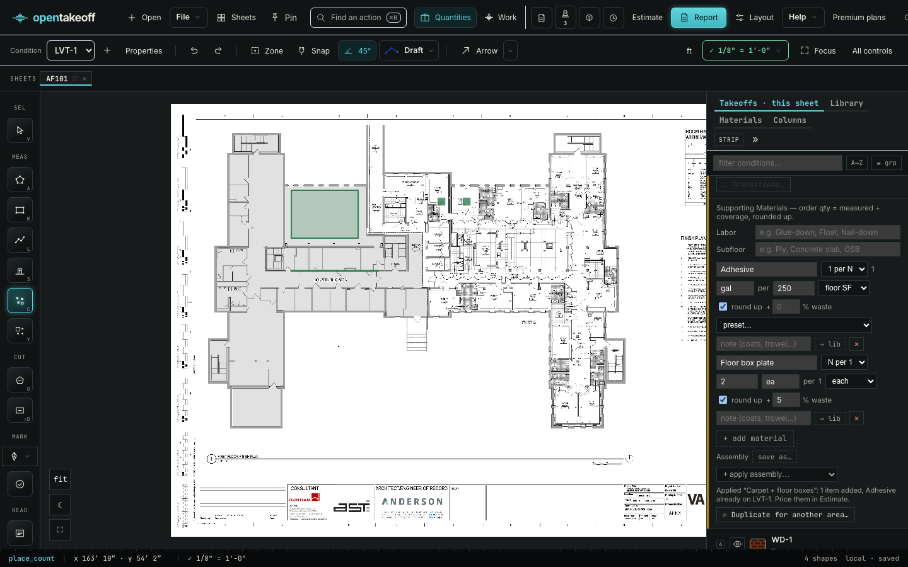
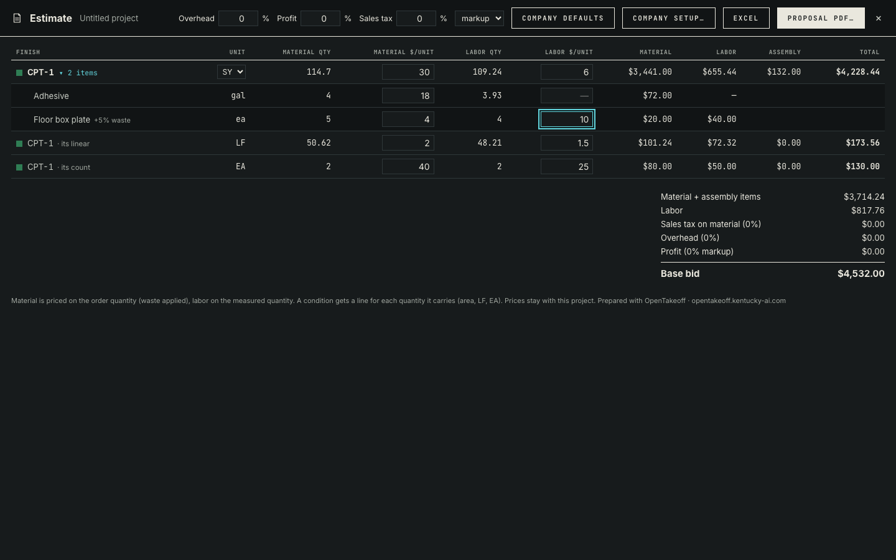

# Estimate lines for every quantity, assemblies, always-on watermark

The bug: under one condition (CPT-1) draw a rectangle (SF), a line (LF) and two counts (EA). The Report shows all three. Before this change the Estimate priced only the SF; LF and EA never reached it. Now each quantity kind a condition carries is its own estimate line, and the condition's assembly items price on its first line. All prices below are placeholders typed by the script, not real pricing.





An item with its own rule and waste (*2 plates per EA, +5% waste*), saved as an assembly and applied to LVT-1 (its existing Adhesive is skipped, no price carried):







Hand check of the last screenshot (the rectangle measured 983.16 SF, the line 48.21 LF; CPT-1 waste 5%):

| Line | Material | Labor | Assembly | Total |
|---|---|---|---|---|
| CPT-1 SY | 114.70 SY × 30 = 3,441.00 | 109.24 SY × 6 = 655.44 | adhesive 4 × 18 = 72.00, plate 5 × 4 = 20.00, plate labor 4 × 10 = 40.00 → 132.00 | 4,228.44 |
| CPT-1 LF | 50.62 × 2 = 101.24 | 48.21 × 1.5 = 72.32 | | 173.56 |
| CPT-1 EA | 2 × 40 = 80.00 | 2 × 25 = 50.00 | | 130.00 |
| Base bid (0% markups) | | | | 4,532.00 |

The plate orders 2 per EA × 2 EA × 1.05 = 4.2 → 5 whole; its labor prices the measured 4 (no waste, no round-up).

## Reproduce

```bash
cd web
npm run dev -- --port 5191 --strictPort &
PLAYWRIGHT_MODULE=/path/to/playwright/index.mjs node --import tsx scripts/verify-assemblies-estimate.mjs ../docs/review/assemblies-estimate-lines http://localhost:5191/
```

Observed on 2026-11-03 (Node 24.18.0, headless Chrome): 21 of 21 checks passed ([results.json](results.json)). The script compares the panel with `priceEstimate` run on the project as saved in IndexedDB, unzips the downloaded Excel (every tab: the watermark cell and the `oddFooter` print footer) and parses the downloaded proposal PDF (every page: the diagonal *OpenTakeoff* and the footer line).

Pure tests: `web/test/estimateLines.test.ts`, `web/test/assemblies.test.ts`, `web/test/estimateWatermark.test.ts`.
