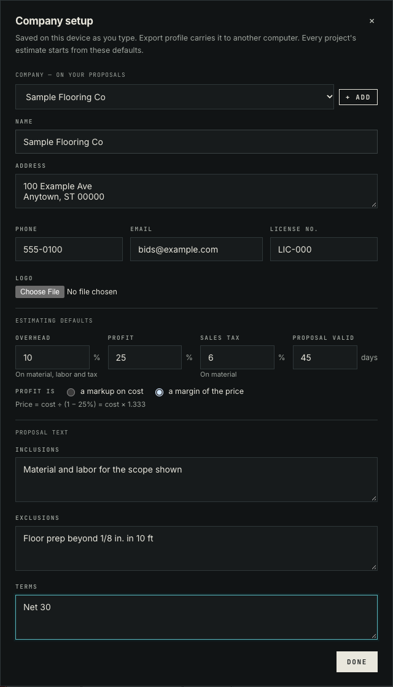
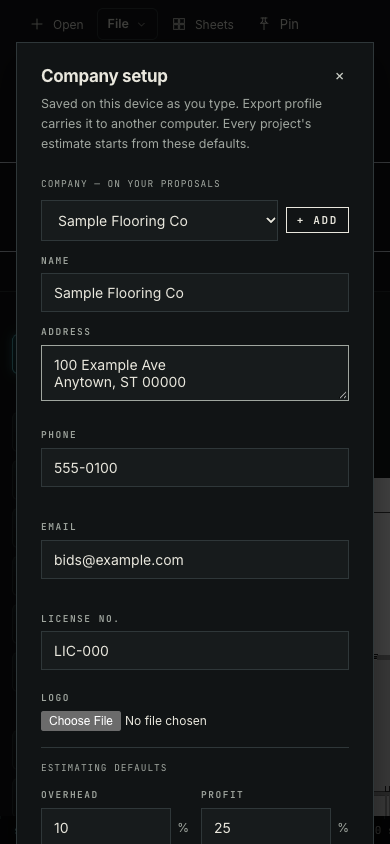

# Company setup

**File → Company setup…** (also in Find an action, and linked from Report → Project info) holds who the firm is and how it prices, once per device. All values in the screenshots are placeholders.

| Section | Fields | Saved in |
|---|---|---|
| Company | Trade name, address, phone, email, license no., logo (several trade names allowed) | `opentakeoff_company_profiles` (lib/identity.js) |
| Estimating defaults | Overhead %, profit % as a markup or a margin, sales tax % on material, proposal validity (days) | `opentakeoff_estimating_defaults` (lib/companySetup.js) |
| Proposal text | Inclusions, exclusions, terms | same |

Nothing is pre-filled. Fields save as they change. The `.otprofile` carries both records. Importing a profile without them leaves the device's company setup alone, and Reset profile keeps it. Project info and Company setup now render one shared form (`components/CompanyIdentity.jsx`).





## Reproduce

```bash
cd web
npm run dev -- --port 5191 --strictPort &
PLAYWRIGHT_MODULE=/path/to/playwright/index.mjs node scripts/verify-company-setup.mjs ../docs/review/company-setup http://localhost:5191/
```

Observed on 2026-10-24 (Node 24.18.0, headless Chrome): 16 of 16 checks passed. [results.json](results.json) lists each one:

- File menu opens the dialog.
- Typing never triggers canvas shortcuts.
- The margin preview reads × 1.333.
- Every field lands in storage.
- Esc closes the dialog.
- Project info shows the same trade name and links to Company setup, which reopens with the saved values.
- Export profile carries both records.
- After wiping them, Import profile restores them.
- No sideways scroll at 390 px.
- No page errors.

| Command | Expected | Observed |
|---|---|---|
| `node --import tsx --test test/companySetup.test.ts test/identity.test.ts test/profile.test.ts` | pass | 17/17 |
| `npm run check --prefix web` | pass | pass (3,554 tests, 0 failed) |
| `node scripts/check-doc-links.mjs` | OK | OK |
