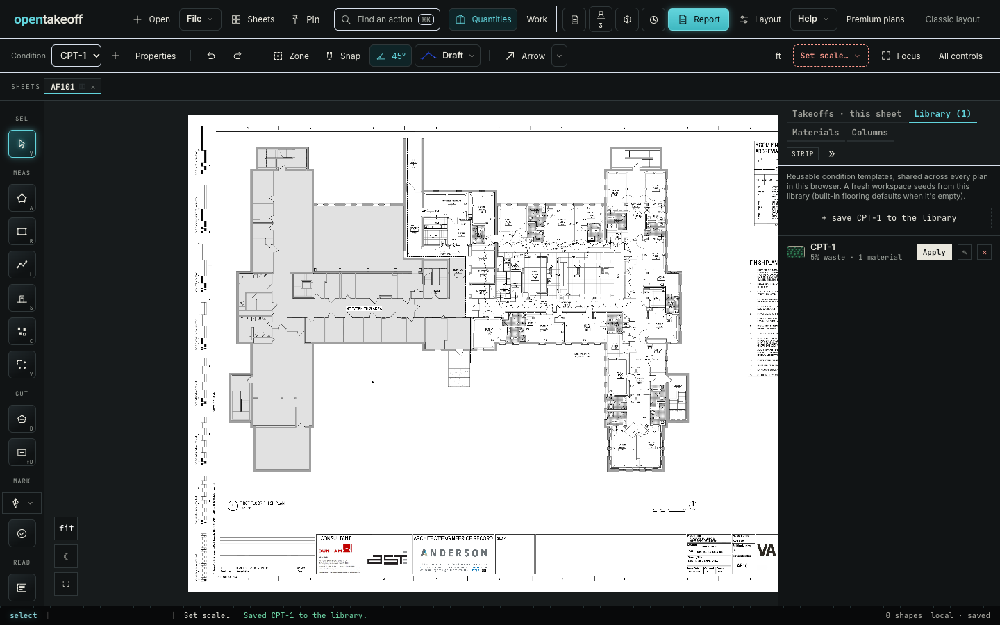

# Estimate pricing engine

`web/src/lib/estimate.js` prices a takeoff from prices the estimator enters. There is no UI yet; the estimate panel, company setup, bid proposal and MCP tools build on this engine.

| | Priced on | Source |
|---|---|---|
| Condition material | Order quantity, waste applied (`total_sf_net`, `sy_net`, `lf_net`; EA has no waste) | `condition.pricing.material`, $ per `unit` |
| Condition labor | Measured quantity, no waste | `condition.pricing.labor`, $ per `unit` |
| Supporting material rows | Whole packages (`conditionTotals` already rounds up) | `materials[].price`, $ per the row's unit |
| Sales tax | Material + material rows | `tax_pct` |
| Overhead | Material + labor + tax | `overhead_pct` |
| Profit | Cost + overhead, as a markup (× 1 + p) or a margin (÷ 1 − p) | `profit_pct`, `profit_mode` |

A price that was never entered is `null`: the line is `partial` or `unpriced` and appears in `unpriced`. Only a typed `0` counts as $0. Condition templates never carry `pricing` or material `price`, so every new project starts unpriced.



## Reproduce

```bash
cd web
npm run dev -- --port 5191 --strictPort &
PLAYWRIGHT_MODULE=/path/to/playwright/index.mjs node scripts/verify-estimate-engine.mjs ../docs/review/estimate-engine http://localhost:5191/
```

The script opens the bundled sample, writes placeholder prices ($1) onto CPT-1 and its material rows in the saved project, reloads, then saves CPT-1 to the Library and reads the stored template back.

| Check | `main` (control) | This branch |
|---|---|---|
| Priced CPT-1 survives a reload | pass | pass |
| Saved template has no `pricing` | pass | pass |
| No template material carries a `price` | **fail** | pass |
| No page errors | pass | pass |
| Total | 6/7 | 7/7 |

Observed on 2026-10-24 (Node 24.18.0, headless Chrome). [results.json](results.json) lists each check for this branch.

| Command | Expected | Observed |
|---|---|---|
| `node --import tsx --test test/estimate.test.ts` | 14 pass | 14 pass |
| `npm run check --prefix web` | pass | pass (3,548 tests, 0 failed) |
| `npm test --prefix mcp` | pass | 286/286 |
| `npm run check --prefix protocol` | pass | 61/61 |
| `node scripts/check-doc-links.mjs` | OK | OK |
