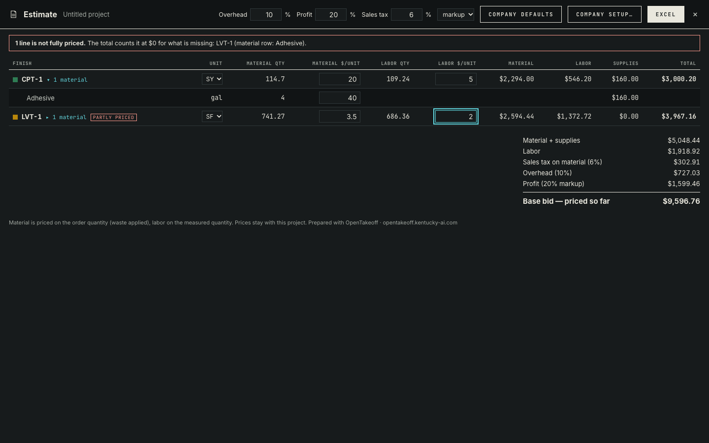
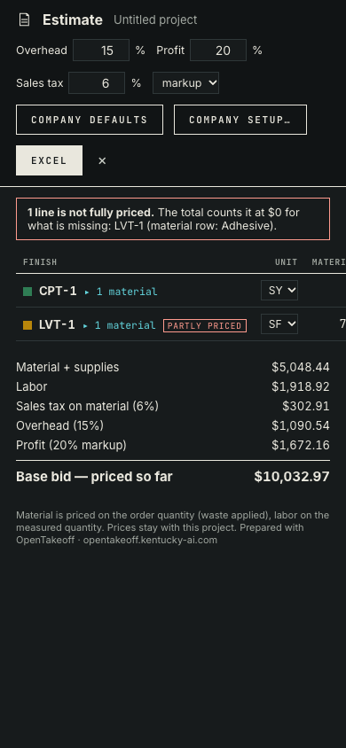

# Estimate panel and Excel

**Estimate** (toolbar in both layouts, Find an action, Report header) prices what was measured, using `lib/estimate.js`. All prices shown are placeholders typed by the script, not real pricing.



The run behind the screenshot is a real takeoff. It sets the sample's own scale ("Plan says 1/8″ = 1′-0″"), then traces one CPT-1 room and one LVT-1 room with the Area tool. CPT-1 is priced per SY with its adhesive priced. LVT-1 is priced per SF and its adhesive is left empty on purpose, so the panel shows **PARTLY PRICED**, the banner names the missing row, and the total reads **Base bid — priced so far**.

Hand check of the screenshot:

| Step | Value |
|---|---|
| Material + supplies: 2,294.00 + 160.00 + 2,594.44 | 5,048.44 |
| Sales tax 6% on material | 302.91 |
| Cost: 5,048.44 + labor 1,918.92 + 302.91 | 7,270.27 |
| Overhead 10% | 727.03 |
| Profit 20% markup on 7,997.30 | 1,599.46 |
| Base bid | 9,596.76 |



At 390 px the table scrolls sideways inside the panel; the page itself doesn't.

## Reproduce

```bash
cd web
npm run dev -- --port 5191 --strictPort &
PLAYWRIGHT_MODULE=/path/to/playwright/index.mjs node --import tsx scripts/verify-estimate-panel.mjs ../docs/review/estimate-panel http://localhost:5191/
```

Observed on 2026-10-24 (Node 24.18.0, headless Chrome): 16 of 16 checks passed ([results.json](results.json)).

The checks compare the panel against `priceEstimate` run on the project as saved in IndexedDB:

- Markups are seeded from Company setup.
- Prices land on the conditions, and the supply price lands on the right material row.
- `estimate_settings` is saved.
- The panel's base bid equals the engine's.
- The Excel file has Estimate, Materials and Unpriced tabs, the engine's base bid as a number cell, and the watermark.
- A later Company setup change leaves the project's 10% overhead alone until **Company defaults** is pressed.
- A reload shows the same base bid.
- No page errors.

| Command | Expected | Observed |
|---|---|---|
| `node --import tsx --test test/estimateExport.test.ts test/takeoffDocument.test.ts` | pass | 11/11 |
| `npm run check --prefix web` | pass | pass (3,559 tests, 0 failed) |
| `npm test --prefix mcp` | pass | 286/286 |
| `npm run check --prefix protocol` | pass | 61/61 |
| `npm run check:tool-count --prefix mcp`, `check:wiki`, `check:protocol-resources` | pass | pass |
| `node scripts/check-doc-links.mjs` | OK | OK |
