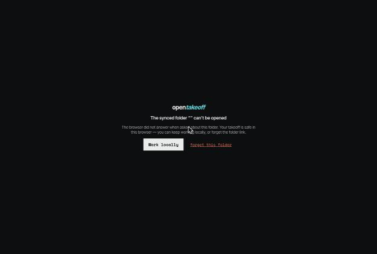

# Folder sync: a permission query that never answers no longer blanks the app

## What was wrong

With a folder link saved, boot asks the browser whether the folder is still allowed
(`queryPermission`). Chrome can leave that query pending forever when the folder no longer
answers. `FolderGate` renders nothing while it waits, so the page stayed blank with no message
and nothing in the console. Seen on the production site on 2026-11-14 with a real linked folder:
`queryPermission` was still pending after 5 seconds in both `read` and `readwrite` mode.

## What changed

`queryFolderPermission` races the query against a 3 second timer and returns `"unresponsive"`
when the browser has not replied. At boot, `FolderGate` routes that to the existing
"The synced folder can't be opened" screen, which already offers **Work locally** and
**forget this folder**. Mid-session callers only test for `"granted"`, so a silent query reads
as a lapsed folder and the reconciler treats it as offline, as before.

## Measured, same steps on both builds

Steps, run in Chrome against a clean origin:

1. Load the app.
2. Save a folder link: put an OPFS directory handle under `fsync:handle` and a scope string
   under `fsync:scope` in the `meta` store.
3. Replace `FileSystemHandle.prototype.queryPermission` with a function returning a promise
   that never settles.
4. Remount the gate by routing to `/projects` and back to `/`.

| Build | Root after 1.5 s | Root later |
|---|---|---|
| `main` at `f15ff0f` (deploy `6af7e661`) | empty | empty at 8 s, `#root` has 0 children |
| this branch, `localhost` | empty | at 4 s: "The synced folder can't be opened. The browser did not answer when asked about this folder." with **Work locally** and **forget this folder** |

Clicking **Work locally** on this branch mounted the canvas with the sample plan.



The folder name is empty in the screenshot because the stand-in OPFS root handle has no name; a
real linked folder shows its name there.

## Tests

`web/test/fsAccessPermission.test.ts`: answered queries pass through, a throwing query reads as
denied, a query that never settles returns `"unresponsive"` within the bound, and an answered
query clears its timer.

```
cd web && node --import tsx --test test/fsAccessPermission.test.ts
```

## Not covered

Why Chrome leaves the query pending for a given folder was not investigated. The request made
by the **Resume folder sync** button (`requestPermission`) is not bounded, because it waits on
the person answering a browser dialog; that screen already has a way out.
