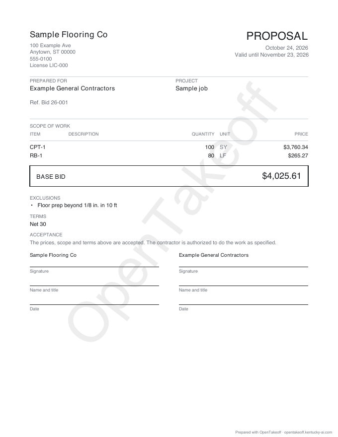

# MCP 0.9.99: estimate verbs

Five tools give an agent the canvas's Estimate panel and Proposal dialog over the same engine (`web/src/lib/estimate.js`): `set_pricing`, `set_estimate_settings`, `estimate_summary`, `export_estimate`, `export_proposal`. Prices, markups, company and client in this run are placeholders.



The itemized lines ($3,760.34 + $265.27) add to the base bid ($4,025.61). That bid equals the hand math in the script:

- material $2,200 + 3 pails × $45 + $120
- labor $500 + $80
- 6% tax on material, 10% overhead, 15% markup

## Reproduce

```bash
npm run build --prefix mcp
node mcp/scripts/verify-estimate-tools.mjs docs/review/mcp-estimate
```

The script drives the **built** server (`mcp/dist/server.js`) over stdio with the MCP SDK client, the way an AI app does. Observed on 2026-10-24 (Node 24.18.0): 11 of 11 checks passed ([results.json](results.json)):

- `tools/list` carries the five verbs.
- SY material is priced on the waste-adjusted order and labor on the measured SY.
- An unpriced supply row is named.
- An unknown row is refused with the condition's real rows.
- The summary total equals the hand math.
- The workbook has the base-bid cell and the watermark.
- The proposal is one itemized page carrying the engine's base bid.
- `undo_last` reverses a settings write in one step.
- `export_takeoff` carries the prices and project records.
- A fresh server's `import_takeoff` prices the same total.

The first run of this script failed on `export_takeoff`. Its wire output schema rejected the new `estimate_settings` key, which the session-level unit tests can't see. The schema is fixed, and `test/estimate.test.ts` now checks the payload against a strict copy of it. Run against the old schema, that check fails with "Unrecognized key(s) in object: 'estimate_settings'".

| Command | Expected | Observed |
|---|---|---|
| `npm test --prefix mcp` (incl. `test/estimate.test.ts`, 9 tests) | pass | 295/295 |
| `npm run typecheck --prefix mcp`, `check:tool-count`, `check:wiki`, `check:protocol-resources`, `check:versions`, `smoke:dist` | pass | pass (58 default tools, 60 gated, 0.9.99 in 7 fields) |
| `evals/mcp-workflow-bench` (score tests + default run + the three plan-set references) | pass | pass |
| `npm run check --prefix web` | pass | pass (3,568 tests, 0 failed) |
| `npm run check --prefix protocol` | pass | 61/61 |
| `node scripts/check-doc-links.mjs` | OK | OK |
