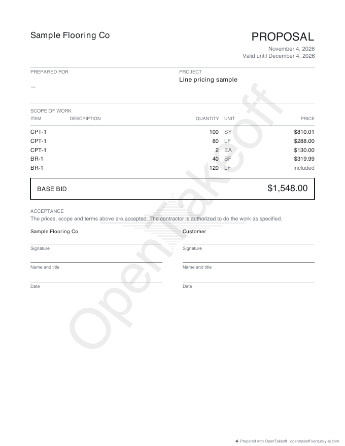

# MCP prices every estimate line; a bordered run's derived line is optional

Two follow-ups to the multi-line estimate (#597). All prices are placeholders typed by the script, and the plan is the bundled demo plan.

1. **`set_pricing` prices every line.** A new `line` argument (`LF`, `EA`, or `SF` for a second area line) writes `pricing.by_unit[line]`. Without it, the call prices the main line exactly as before, and `unit` still picks the main line's unit, so an old `{unit: "LF"}` call on a bordered base condition does what it always did.
2. **A bordered linear condition reads fully priced again.** A linear condition with a thickness carries LF and border SF from the same run. Since #597 it shows two lines, and the unpriced second line made old projects read "partly priced". That derived line is now optional: it can be priced, but empty it is carried in the main line, so it is not missing, not on the Unpriced tab, and an itemized proposal prints "Included".

## Measured: saved bordered projects, three engines

The same saved conditions priced by the engine before #597 (`d9d2fd15^`), by `main` before this PR (`0e1e0be0`), and by this branch (rows from today's `conditionTotals`):

| Case | before #597 | main (#597) | this branch |
|---|---|---|---|
| BR-1 4 in border, priced on SF, 10% waste | $340.00, complete | $340.00, **partly priced** (LF unpriced) | $340.00, complete (LF optional) |
| BR-2 6 in border, SY picked | $627.09, complete | $627.09, **partly priced** | $627.09, complete |
| RB-4 4 in run, LF picked | $1,197.12, complete | $1,197.12, **partly priced** (SF unpriced) | $1,197.12, complete (SF optional) |
| BR-3 12 in border, labor only ($0 material) | $264.00, complete | $264.00, **partly priced** | $264.00, complete |

## Measured: the built MCP server over stdio

`results.json` has 16/16 checks passing, including:

- `set_pricing {line: "LF"}` and `{line: "EA"}` write `by_unit`. `estimate_summary` lists all three CPT-1 lines (SY / LF / EA) with quantities, rates, status and `missing`. The total matches the hand math: 105 SY × 30 + 100 SY × 6 + 84 LF × 2 + 80 LF × 1.5 + 2 × 40 + 2 × 25 = $4,168.
- `{line: "SF"}` on a condition whose main area line is SY is refused, because it would misprice the main line. An old `{unit: "LF"}` call still switches the main line.
- A bordered BR-1 imported the way the canvas saves it (thickness 4 in, border SF on the run) reads `complete: true` with `unpriced: []`. Its lines are SF priced at $320 and LF optional at $0, and the workbook has no Unpriced tab.



## Reproduce

```bash
npm ci --prefix web && npm ci --prefix mcp && npm run build --prefix mcp
node --import ./web/node_modules/tsx/dist/loader.mjs docs/review/mcp-line-pricing/verify.mjs
```
