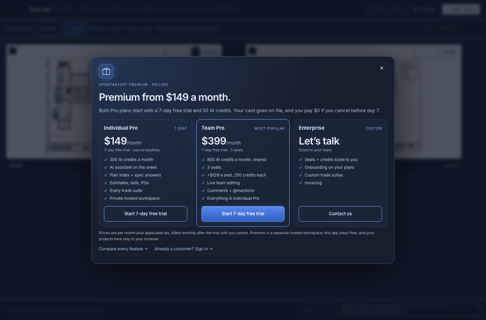
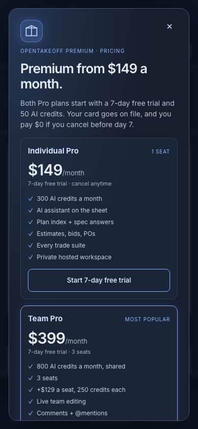

# Premium plans replace Request Premium

The early-access form is replaced by a pricing sheet with the published OpenTakeoff Premium prices. Its trial buttons open sign-up at start.kentucky-ai.com with the chosen plan.

| | Before | After |
|---|---|---|
| Toolbar and gallery button | Request Premium | Premium plans |
| ⋯ menu | Request Premium — join the early-access list | Premium plans — pricing and 7-day free trial |
| Dialog | Email, name, company, role form (Netlify Forms) | Individual Pro $149, Team Pro $399, Enterprise; trial and sign-in links |
| Data sent from the app | Form fields to Netlify Forms | None (links open in a new tab) |





## Reproduce

```bash
cd web
npm run dev -- --port 5191 --strictPort &
PLAYWRIGHT_MODULE=/path/to/playwright/index.mjs node scripts/verify-premium-plans.mjs ../docs/review/premium-plans http://localhost:5191/
```

Observed on 2026-10-19 (Node 24.18.0, headless Chromium): 19 of 19 checks passed. [results.json](results.json) lists each one: button labels, no "Request Premium" text left, every price and credit line, both trial links with their plan and `target=_blank`, the sign-in link, no form or input in the dialog, Escape closes it and records the 30-day snooze, no sideways scroll at 390 px, and no page errors.

`npm run check` (typecheck, lint, tests, build) passed.
