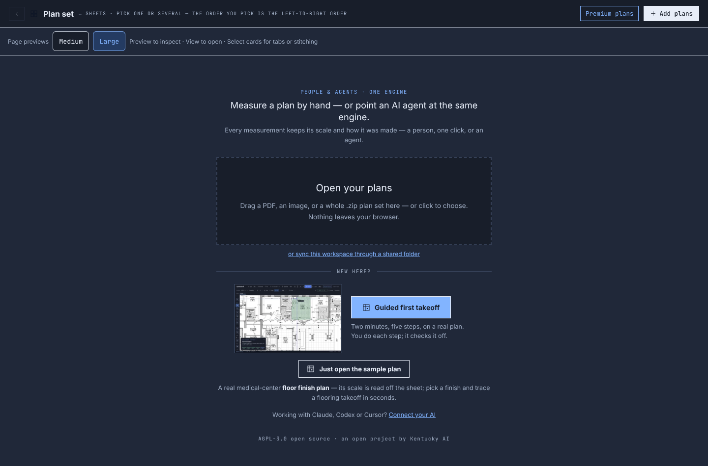
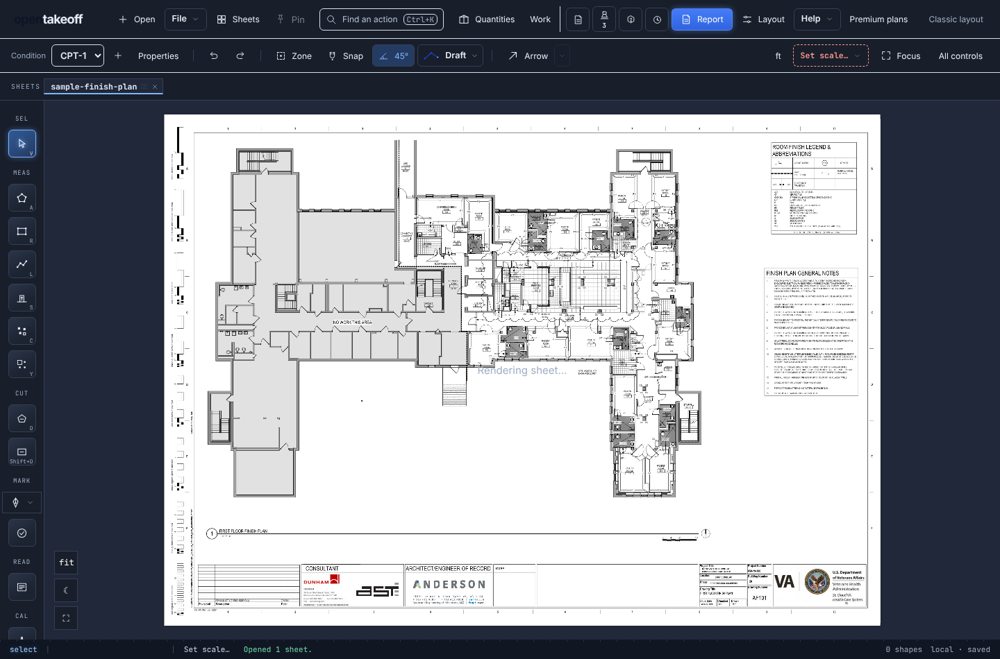
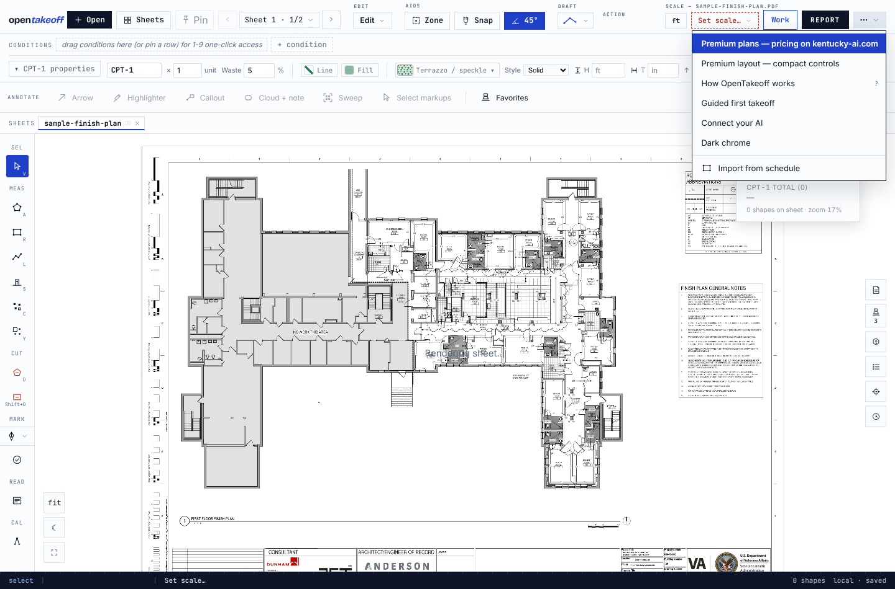

# Premium plans buttons link to kentucky-ai.com pricing

Every **Premium plans** entry point now opens <https://kentucky-ai.com/#pricing> in a new tab. The in-app plans
dialog and its hardcoded prices are removed, so this app can no longer show a stale price: plans, prices and the
7-day trial sign-up are stated only on kentucky-ai.com. The unprompted plans dialog after closing the Report is
removed with it.

| Entry point | Before | After |
|---|---|---|
| Plan gallery header | Opened the in-app plans dialog | Opens kentucky-ai.com/#pricing in a new tab |
| Workspace header | Opened the in-app plans dialog | Opens kentucky-ai.com/#pricing in a new tab |
| Classic ⋯ menu | "Premium plans — pricing and 7-day free trial" (dialog) | "Premium plans — pricing on kentucky-ai.com" (new tab) |
| Closing the Report | Could open the dialog unprompted | Nothing opens |

## Evidence

Browser run against the dev server with the bundled sample plan (`checks.json`, all pass):

```
PASS  Gallery "Premium plans" opens the pricing section in a new tab
PASS  Gallery "Premium plans" shows no in-app plans dialog
PASS  every Premium button reads "Premium plans"
PASS  Workspace "Premium plans" opens the pricing section in a new tab
PASS  Workspace "Premium plans" shows no in-app plans dialog
PASS  Classic ⋯ menu is reachable
PASS  ⋯ menu "Premium plans" opens the pricing section in a new tab
PASS  ⋯ menu "Premium plans" shows no in-app plans dialog
PASS  no page errors
```





Reproduce from `web/` with `npm run dev -- --port 5191` running:

```
PLAYWRIGHT_MODULE=/path/to/playwright/index.mjs node scripts/verify-premium-plans.mjs ../docs/review/premium-pricing-link http://localhost:5191/
```
