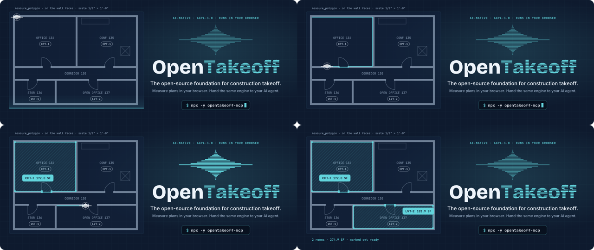
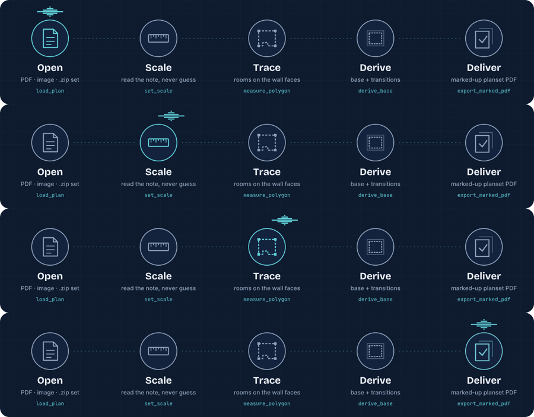

# README overhaul: review evidence

The README front page was rebuilt around a generated, animated hero, per-client MCP install,
"What's new" and the contribution evidence bar. The long feature prose moved unchanged to
[`docs/TOUR.md`](../../TOUR.md).

## The hero animates as designed

Frames captured in real time from `docs/img/brand/hero.svg` in headless Chrome over the
DevTools protocol, at 1.2 s, 3.0 s, 5.0 s and 9.0 s into the 11 s loop: the scan line sweeps,
the agent star traces office 134 on its wall faces (crossing the door on the wall centerline),
the room fills and reports its area, then open office 137 does the same.



The full loop at 10 fps: [hero.gif](hero.gif). Under `prefers-reduced-motion: reduce` the
SVG shows the finished state with no motion, and the cursor and scan line are hidden.

The illustrated areas follow the engine's frame: 18 px per foot is `1/8" = 1'-0"` at render
scale 2.0. Office 134 is 172.0 SF and open office 137 is 102.9 SF, computed from the ring
vertices by `gen-readme-art.mjs`.

## The how-it-works strip

Frames from `docs/img/brand/how-it-works.svg` at 0.5 s, 3.0 s, 5.0 s and 8.5 s: the star
steps through Open, Scale, Trace, Derive and Deliver, and each stage lights as it arrives.



## Checks

| Check | Expected | Observed |
|---|---|---|
| `npm run check --prefix web` (Node 24.18.0) | pass | pass |
| `node scripts/check-doc-links.mjs` | every link resolves | 45 files, every relative path and anchor resolves |
| `npm run check:tool-count --prefix mcp` | 0 stale | 21 markers, 0 stale, 58 default / 60 gated / 11 setup tools |
| `npm run check:wiki --prefix mcp` | pass | 58 default tools, 9 wiki pages checked |
| `npm run check --prefix protocol` | pass | 11 schema files, 16 transport cases |
| README tool table | the 58 default tools, each once | 58 tools in 11 groups, matching `TOOL_NAMES` in `mcp/src/staging.ts` |

## Reproduce the art

```bash
D=$(mktemp -d) && npm i --prefix $D opentype.js@1.3.4 @fontsource/bricolage-grotesque@5 @fontsource/jetbrains-mono@5 @fontsource/inter@5
node docs/img/brand/src/gen-readme-art.mjs $D/node_modules
```

## Not verified

- The Cursor and VS Code install buttons use each editor's public install-link format. They
  were not clicked through in either editor.
- GitHub's rendering of the animated SVG was checked on the pushed branch in Chrome only.
