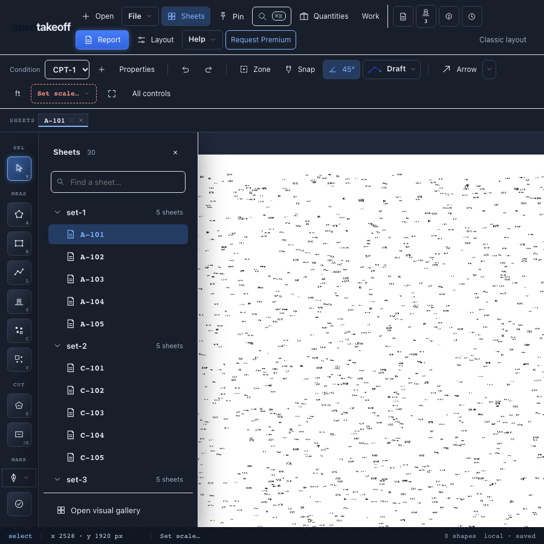

# Sheet tree review — October 13, 2026

Updated PR #523 against main `9624be84`. The canvas keeps the schedule-code
plan-set index and records page counts in both layouts while the Premium tree
also receives them. No measurements or project formats change.

Fixed a startup race in the page-count cache: removing a file before saved
counts load must discard its saved count. Early removals and new counts are
applied together before the hydrated map is displayed or saved.

| Check | Expected | Observed |
|---|---|---|
| Remove `removed.pdf` before loading `{removed.pdf: 8, kept.pdf: 3}` | Only `kept.pdf: 3` remains | Before fix: both remained; after fix: only `kept.pdf: 3` |
| Replace an eight-page file before counts load | New two-page count; other file preserved | Two pages; other file preserved |
| Sheet-name, tree, label and page-count unit tests | All pass | 56 passed, zero failures |
| Full web check | Typecheck, lint, ORT, tests, corpus benchmark, build, distribution check pass | Passed; 3,499 tests passed, four skipped, zero failures |
| Browser walkthrough | All checks pass | 21/21 passed |
| Generated sheet numbers after gallery / reload | 30 / 30 | 30 / 30 |
| PDF workers after reload | At most one | One |
| Reader maximum | Less than 50 ms | 2.4 ms (p95 2.3 ms) |
| Narrow viewport | No horizontal page scroll | 900 px content at 900 px viewport |

MCP tool-count and wiki checks, protocol checks and documentation links also
passed. Corpus results remain byte-identical to the committed baseline.
OCR models were not staged; the four model-dependent tests were skipped.
The production build emitted its existing chunk-size warning. The browser
script intentionally blocks remote fonts and analytics; those resource errors
are recorded separately from app errors.

## Reproduce

Use Node 24, install web, MCP and protocol dependencies, then from the repo root:

```sh
npm run check --prefix web
npm run check:tool-count --prefix mcp
npm run check:wiki --prefix mcp
npm run check --prefix protocol
node scripts/check-doc-links.mjs
cd web
node --import tsx --test test/pageCounts.test.ts test/sheetName.test.ts test/sheetNamer.test.ts test/sheetTree.test.ts test/sheetLabels.test.ts
PLAYWRIGHT_MODULE=/path/to/playwright/index.mjs BROWSER_PATH=/path/to/chromium node scripts/verify-sheet-tree.mjs ../docs/review/sheet-folder-tree/2026-10-13/results.json
```

[Browser results](results.json), [unit-test output](unit-tests.txt),
[narrow layout](07-tree-900px-wide.png),
[light theme](05-tree-light-theme.png),
[graphite theme](06-tree-graphite-theme.png),
[keyboard trace protection](10-trace-in-progress-after-keys.png).


