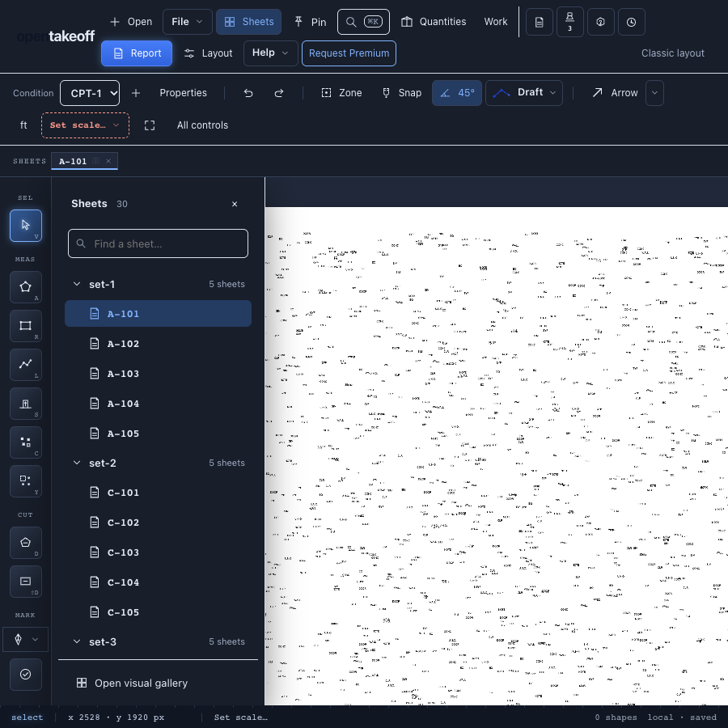

# Sheet tree integration — October 18, 2026

Updated PR #523 (`980f996`) against main `0074c37`. The only conflict was in
`CHANGELOG.md`; both the sheet-tree entries and the reconciled-cutout entry
are retained. No additional runtime behavior was introduced in the resolution.

| Check | Expected | Observed |
|---|---|---|
| Full web check | Pass | 3,504 passed, 4 skipped, zero failures; typecheck, lint, benchmark and build passed |
| Browser walkthrough | All checks pass | 21/21 passed |
| Sheet numbers after gallery / reload | 30 / 30 | 30 / 30 |
| PDF workers after reload | At most 1 | 1 |
| Reader maximum | Below 50 ms | 2.7 ms (p95 1.3 ms) |
| Narrow viewport | No horizontal page scroll | 900 px content at 900 px viewport |
| Tree Delete/Backspace keys | Preserve selected shape and unfinished trace | Preserved; canvas Delete control removes the shape |

MCP tool-count/wiki, 61 protocol tests and documentation links passed.
OCR models were not staged. The build emits its existing chunk-size warning.
The browser script blocks external fonts and analytics; no other console errors
were recorded. The narrow screenshot was visually inspected.

## Reproduce

Use Node 24 and install web, MCP and protocol dependencies. From the repository root:

```sh
npm run check --prefix web
npm run check:tool-count --prefix mcp
npm run check:wiki --prefix mcp
npm run check --prefix protocol
node scripts/check-doc-links.mjs
cd web
PLAYWRIGHT_MODULE=/path/to/playwright/index.mjs BROWSER_PATH=/path/to/chrome node scripts/verify-sheet-tree.mjs ../docs/review/sheet-folder-tree/2026-10-18/results.json
```

[Full browser results](results.json), [narrow layout](07-tree-900px-wide.png),
[light theme](05-tree-light-theme.png), [graphite theme](06-tree-graphite-theme.png),
and [trace protection](10-trace-in-progress-after-keys.png).



## Dense-page timing follow-up

The first CI run failed one timing assertion: the 59,002-item page took
51.9 ms against the existing 50 ms budget while the reader was instrumented
for V8 coverage. All other 3,506 tests passed in that run.

The reader now avoids per-bucket array allocations for small pixel buckets,
collects only rows containing possible labels, and skips label-free angles.
The comparison order and reader version are unchanged. Public-sheet and
reference-reader equivalence checks remain under coverage, with an additional
regression covering neighbouring angles, differing heights and bucket ties.

The timing checks now run in a child process without coverage instrumentation,
so they measure the reader's runtime rather than the coverage probes. The
50 ms dense-page budget, 5 ms no-label budget and 10× growth bound are unchanged.

[Paired before/after results](reader-performance.json), Node 24.18.0 on the
same machine, alternating execution order, 3 warmups and 15 measured reads:

| Synthetic page | Before median | After median |
|---|---:|---:|
| 30,002 items | 2.45 ms | 1.40 ms |
| 30,602 items, including 300 sheet references | 3.13 ms | 2.14 ms |
| 59,002 items | 4.74 ms | 3.11 ms |

These are local timings, not claimed GitHub runner timings. Reproduce from `web/`:

```sh
node --import tsx scripts/measure-sheet-name.mts 059ffa2
node --import tsx --test --experimental-test-coverage test/sheetName.test.ts
```

After this follow-up, the full web check passes (3,504 passed, 4 skipped),
the 10 sheet-reader tests pass with coverage, and the rebuilt browser
walkthrough passes all 21 checks. The linked screenshots and results are
from that rebuilt app.
